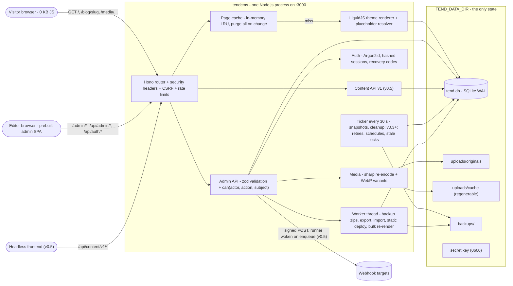
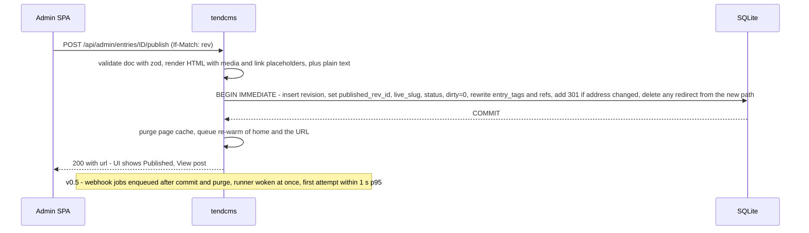

# Tend CMS: Final Plan

*Plan date: 2026-10-25 (Sunday). This version was revised the same day after an engineering review and a beginner review. It assumes one developer who schedules about 10 hours a week, of which about 8 are productive, starting Monday 2026-10-26. The project folder is `/Users/jep/Developer/Personal/Repo/cms`.*

> **What was checked today.** Items marked **(checked today)** were re-checked on 2026-10-25 against several sources: the npm registry (versions, publish dates, dependencies, licences), GitHub, RDAP, nodejs.org (the dist index and the nodejs/Release schedule) and the Railway, Netlify and Render docs. Two SQLite behaviours were also reproduced locally with sqlite3 3.54. Market and competitor facts come from the research briefs dated today.

---

## 0. The plan on one screen

| Topic | Decision |
|---|---|
| **Name** | **Tend**. Every public title, listing and handle says **"Tend CMS"**. You create a site with `npm create tend@latest my-site` and run it with `npm start` inside the folder. Tagline: *"Tend your site, not your server."* |
| **What it is** | An open-source (MIT) all-in-one CMS for small websites. One Node.js process serves the admin, the public site and the API. All state lives in one `data/` folder: a SQLite file, media, backups and a secret key. |
| **Promises** | **Running on your computer in 5 minutes; online in about 20, plus connecting your domain.** Zero required configuration. Works without email. Never loses typing. Every mistake can be undone. Public pages ship 0 KB of JavaScript unless you add analytics or embeds. Nothing basic is paywalled. |
| **Stack** | Node 26 LTS (Node 24 is still supported). Hono 4.13. SQLite through better-sqlite3 13 with Drizzle 0.45. A React 19 + Vite 8 admin with the Tiptap 3 editor. LiquidJS themes. sharp for images. Auth written in-house (Argon2id). The published `tendcms` package has **3 direct runtime dependencies**, and its whole install tree is locked by a published `npm-shrinkwrap.json`. |
| **Releases** | **v0.1 "Seedling"** (developer preview): run on your computer, one-click Railway or Docker, and move a local site online from a backup. **v0.2 "Rooted"**: the first release recommended for non-technical owners (phone editing, HEIC photos, restore from the admin). **v0.3 "Sprout"**: your own domain, optional email, passkeys, scheduling. **v0.5 "Leaf"** (public beta): forms, search, Content API, static deploy. **v0.8 "Transplant"**: WordPress and Squarespace import. **1.0 "Bloom"**: encrypted off-site backups, 2FA, translations. |
| **Timeline** | About **1,080 planned hours**: raw estimates × 1.5. At 10 h/week: v0.1 **Nov 2027** (late case Mar 2028), v0.5 **Nov 2028** (late case Jun 2029), 1.0 **Jul 2029** (late case Apr 2030). At 15 h/week: v0.1 Jul 2027, v0.5 Mar 2028, 1.0 Aug 2028. The plan is redone after M1 using measured hours. |
| **Your Vercel/Supabase accounts** | Vercel hosts the docs site now. From v0.5, developers can push the public site as static files to Cloudflare (free, commercial use allowed) or Vercel (business sites need Pro). The CMS server itself needs a persistent disk, so it runs on Railway, a VPS or Docker. Supabase is not used in v1; Supabase Storage works as an off-site backup target at 1.0. |

---

## 1. Name and brand

### Recommendation: **Tend**

"Tend" means to look after something, the way you tend a garden. It is one syllable, hard to misspell, and works as a verb ("tend your site"). The research found no CMS called Tend.

The bare word is hard to search for, because a US dental chain, farm-management software and a "Tend: Connect" app all use it. So **every title, video, social handle and listing says "Tend CMS"** and uses `tendcms` as the handle.

- **Tagline:** "Tend your site, not your server."
- **Secondary lines:** "Easy to start. Easy to tend." / "Plant a site in minutes. Tend it for years."
- **Release codenames (marketing only):** Seedling (v0.1), Rooted (v0.2), Sprout (v0.3), Leaf (v0.5), Transplant (v0.8), Bloom (1.0).
- **Brand voice:** calm, plain, reassuring. **The admin UI never uses garden metaphors.** Buttons are plain verbs: "Publish post", "Invite person".
- **Visual identity:** a simple sprout mark in deep green `#1F6F4A` on warm off-white. It works in one colour and in dark mode. The admin uses the system font stack and makes no third-party font requests.

### Package, CLI and handle names

| Asset | Name | Evidence |
|---|---|---|
| Scaffolder | `create-tend`, run as `npm create tend@latest my-site` | npm E404, so free **(checked today)** |
| Server, CLI and admin package | `tendcms`. Beginners never type it: the generated `package.json` runs it through `npm start`. Developers use `npx tendcms <command>` inside the site folder, which runs the local copy. | npm E404 **(checked today)** |
| Typo guards | `tend-cms` and `create-tendcms`: placeholder packages that print the right command | npm E404 **(checked today)** |
| npm scope | `@tendcms` (first package `@tendcms/sdk` at 1.1) | org endpoint 404 **(checked today)** |
| GitHub | org `tendcms`, repo `tendcms/tend` | `github.com/tendcms` returns 404 **(checked today)** |
| Docker image | `ghcr.io/tendcms/tend:0` before 1.0, then `:1`; mirrored to Docker Hub | follows from the GitHub org |
| Social | `tendcms` on Bluesky and Mastodon | claim in week 1 (not checked) |
| Domains | `tendcms.dev` for docs, demo and blog; `tendcms.app` held for a future managed cloud | RDAP 404 for both, so unregistered **(checked today)**. `tendcms.com` is registered until 2027-04-11; watch it |
| Env vars and cookie | `TEND_*`, `__Host-tend_session` | n/a |

**Known conflicts and rules:**
- The bare npm name `tend` is **taken** by an unrelated file-watcher CLI (v0.5.0, **checked today**). A beginner who guesses `npx tend` would download and run someone else's code. So the docs and CLI output only ever show `npm create tend@latest` and, after that, `npm start`.
- In week 1, ask the `tend` maintainer about transferring the name. Don't depend on the answer.
- Near names exist: Tendenci (a Django CMS for nonprofits) and Tendoo CMS (abandoned since 2019).
- **No trademark search has been done.** Search USPTO and EUIPO for "TEND" in classes 9 and 42 in week 1, before buying domains or announcing anything.

### Alternates (if the trademark search blocks Tend)

1. **Nook**: "A cozy corner for your content."
   - `create-nook` and `nookcms` are free (checked today), and so is the `@nookcms` scope.
   - nookcms.com, .dev, .app and .io were all unregistered in the research.
   - Risks: Barnes & Noble's NOOK marks (Class 9), `@nook` is taken, and a tiny GitLab "Nook CMS" exists.
2. **Pagenest**: "Where your pages live."
   - `pagenest`, `create-pagenest`, `@pagenest` and pagenest.dev were free in the research.
   - Risks: it is generic, and several small 2026 projects already use "PageNest".

**Dropped:** Pagewell (live products), Sprig (a Craft CMS plugin), Kite (KiteCMS has a 9.8 RCE CVE), Easel (Inventables), Hearth (`create-hearth` is taken).

---

## 2. Vision, positioning and the gap

**Pitch.** Tend is an open-source website CMS for people who want their own site without becoming its mechanic.
- **Install:** one command on your computer, one click on Railway, or one Docker line, all from v0.1. A three-step setup in the browser follows, and you finish with a site that already looks finished.
- **Edit:** editors write in a calm, Ghost-style editor with autosave. Status words are honest: "Changes saved, not on your site yet" means exactly that. One click restores an earlier version.
- **Publish:** visitors get pre-rendered pages with zero JavaScript and automatically optimised images. Changes go live in about a second.
- **Move or back up:** click **Download backup**, then choose **Start from a backup** on the new copy. The whole site lives in one folder.
- **Licence:** MIT. Preview, revisions, roles, scheduling and backups are free. There is no telemetry.

### The gap

| What small-site owners need | Who fails at it today | Tend's answer |
|---|---|---|
| A non-developer can set it up | Ghost self-hosting (MySQL, Mailgun, Tinybird); headless CMSs (Payload, Strapi, Directus, Sanity); git-based CMSs (OAuth apps) | Zero required environment variables, a setup wizard, a Railway button and a backup-based move from v0.1, and everything works without email |
| Fast by default | WordPress: about 45% of sites pass mobile Core Web Vitals, against Wix 74% and Duda 85% | Tend owns the theme and rendering pipeline: full-page cache, 0 KB JavaScript, image variants built automatically |
| Pleasant for non-technical editors | Sanity, Strapi and Directus need configuring first; WordPress spreads jargon across two editors | One opinionated editor, plain words, sections instead of layout knobs, and status text that never misleads |
| Basics are free | Strapi Growth ($45/mo for preview and history), Sanity Growth (roles, scheduling), Directus 12 licence keys, Statamic Pro ($349) | MIT, everything included |
| Not tied to one cloud | EmDash 1.0 (Cloudflare and Astro, developer-shaped, no revisions UI) | Docker, Node, Railway or any VPS, plus static deploy to Cloudflare or Vercel (v0.5) |
| No lock-in | Wix, Squarespace, Framer (no design export, price rises) | One folder, a portable export zip (v0.3), a Markdown "exit" export (v0.8), and import from Squarespace's own export file (v0.8) |

### Who it's for

- Novice or AI-assisted developers and freelancers building blogs, portfolios and small-business, club or nonprofit sites, usually to hand over to a non-technical owner.
- Non-technical owners who want to own their site. They host it on Railway's Hobby plan ($5/month) through the one-click template, or on a VPS a friend set up.
- Sites with 1–5 editors, up to a few thousand pages and a few hundred thousand visits a month.

### Who it's not for

- Headless-first app backends (use Payload or Directus).
- E-commerce.
- Newsletter and paid-membership businesses (use Ghost).
- Enterprise SSO, approval chains or audit compliance.
- Multi-tenant SaaS.
- Webflow-style free-form page design.
- Serverless-only or Workers-only hosting for the CMS server, in v1.

---

## 3. Target users and personas

| Persona | Who | Install path | Must-haves | What success looks like |
|---|---|---|---|---|
| **Maya, freelancer and novice developer** (primary installer) | Knows npm and Vercel, uses AI coding tools, builds 3–10 small client sites a year, has never run a VPS | `npm create tend@latest` locally, then **Deploy on Railway** and **Start from a backup** (J10) | One command, no config, a theme that already looks finished, a "Coming soon" page while building, a clean handoff | The client site is online the same afternoon and the client never calls with "how do I…" |
| **Tom, small-business owner** (primary owner, secondary installer) | Runs a bakery, non-technical, left Squarespace after its July 2026 price rise; his domain is probably still at Squarespace Domains | Gets it from Maya, or clicks **Deploy on Railway** himself (works from v0.1, recommended from v0.2) | No terminal, plain words, can't lose anything, a known monthly bill, opening hours shown everywhere, his own domain (v0.3) | Updates the opening hours from his phone and sees them on risebakery.com |
| **Priya, editor or writer** | A volunteer who writes weekly, often on a phone, pastes from Google Docs | Invite link | Clean paste, autosave, a clear "it's on your site now", easy photos (including iPhone ones), undo | Publishes a 300-word post with a photo in 3 minutes or less, unassisted, on a phone |
| **Sam, homelab self-hoster** (tertiary) | Runs Coolify or Docker on a mini PC | `docker compose up -d` | One volume, a healthcheck, backups, low RAM, no phoning home | Under 120 MB RAM when idle; survives updates |

**Anti-persona:** an agency CTO comparing GraphQL federation and SSO. Turning them away keeps the scope small.

---

## 4. Product principles, written as testable rules

Every rule has a check. The **release gate** (§15) says which checks block a release.

| # | Principle | Rule | How it's checked |
|---|---|---|---|
| P1 | **One process, one folder** | All state lives in `TEND_DATA_DIR` (`./data` with npm, `/data` with Docker). Copy the folder, or restore a backup, and you have moved the site. | CI copies `data/` to a second runner, boots it under a different hostname, and compares API output. It also checks that no `localhost` URL appears in the output. |
| P2 | **Zero required configuration** | 0 required environment variables and 0 required config files. The CLI asks at most 1 question. | CI runs `tendcms start` in an empty folder with a clean environment and expects `/admin/setup` to return 200 |
| P3 | **Five-noun budget** | At most 5 new nouns before the first publish: Page, Post, Draft/Published, Site menu, Design | Copy audit of the J1 screens at each milestone |
| P4 | **Five minutes local, about twenty online** | Median time to first publish (TTFP) on your own computer of 5 minutes or less, counted from the command with Node already installed. TTFP "from zero" (no Node installed) is reported next to it. The Railway path takes about 20 minutes or less including account signup and card, excluding the domain. | A scripted J1 run must finish in 120 s of machine time (gate). Usability rounds measure the human times (guidance). |
| P5 | **Never lose work** | After a `SIGKILL` of the server and closing the tab mid-typing, reopening restores everything typed up to 2 s before the kill | Playwright crash test that types continuously while the server is killed; a release is blocked while any lost-work bug is open |
| P6 | **Fast by default** | Default-theme pages contain no executable `<script>`; only `speculationrules` and JSON-LD are allowed. The only exceptions are opt-in: visitor-stats presets (v0.2), **Add code to every page**, and embeds (v0.5). | HTML parse and deterministic byte, image and CLS budgets on every PR; Lighthouse score nightly and on release tags |
| P7 | **Works without email and offline** | Invites, password resets and recovery all work as copyable links or recovery codes. The admin and default theme make no third-party requests. | The e2e suite runs with email unset; Playwright blocks non-local requests and fails on any attempt |
| P8 | **Plain words** | UI strings never contain: slug, permalink, meta, excerpt, schema, entry, entity, instance, payload, deploy, build, invalid, OG, hero, CTA, call to action, injection. "Collection" and "webhook" are allowed only on developer screens. | CI grep over `messages/en.json` |
| P9 | **Undo over confirm** | Reversible actions get an Undo toast or go to Trash. The app has at most **5 confirmation dialogs**: *Delete forever*, *Restore backup*, *Reset site*, *Transfer ownership*, *Remove person*. | Dialog inventory test |
| P10 | **Three clicks to live** | A finished draft goes live with **Publish → Publish post now**, and that's all | e2e click count |
| P11 | **Complexity budget** | v0.1: ≤ 14 database tables, ≤ 20 source dependencies in `tendcms`, **3 direct runtime dependencies for installers** (about 10 installed packages, all shrinkwrapped), 1 process, 0 sidecar services, ≤ 32 settings fields. 1.0: ≤ 21 tables. | A CI script counts them; each PR says which budget it spends |
| P12 | **Accessible by default** | Admin meets WCAG 2.2 AA, reflows at 320 px, and has 44 px touch targets. Every drag action has a button alternative. 0 axe violations. | `@axe-core/playwright` on every screen, plus a manual keyboard and VoiceOver pass each release |
| P13 | **Errors explain and fix** | Every error code has a "what happened" and a "what to do" string, plus a full `https://` docs link. No stack traces outside the logs. | CI fails if a thrown `AppError` code has no copy |
| P14 | **Portable** (from v0.3) | Export, then import, then export again produces identical output | CI round trip |
| P15 | **Status never misleads** | "Live" appears only for a public address. On a published page with newer edits, the status reads "Changes saved, not on your site yet" and **Publish changes** is the main button. | Copy test plus an e2e test on localhost and on a public hostname |

**How a feature gets in.** It must be needed for one of journeys J1–J11 (§6), or requested by at least 3 independent users. It must also fit the P11 budget.

---

## 5. Feature scope by release

Hours below are **raw estimates**. Planned hours multiply them by 1.5, because the engineering review showed the first estimates were about half of reality.

### MVP: v0.1 "Seedling" (developer preview; 280 h raw → about 420 h planned)

| Area | What's included | Raw h |
|---|---|---|
| Install and CLI | `create-tend` has zero dependencies, asks at most one question (the folder) and writes the **exact** `tendcms` version. It installs, starts Tend and opens the browser. `tendcms start` falls back through ports 3001–3010 only when `PORT` is unset and not running in Docker. Friendly Node check. `tendcms doctor`. Exits with a clear message on Vercel, Netlify or Lambda. Prints "Keep this window open" and a full `https://` link for every message. `tendcms theme copy`. | 8 |
| Data and migrations | SQLite in WAL mode. An async repository layer (transactions are synchronous blocks with no `await` inside). Lock file. Snapshot with `db.backup()`. All pending migrations in one transaction with foreign keys handled correctly (§13). Downgrade guard. Migration lint. | 12 |
| Setup | Start screen: **Start a new site** or **Start from a backup** (chunked upload, setup code required, only while no Owner exists, snapshot first). Then 3 steps: *Name your site*, *Create your account*, *Pick a starting point* (Blog, Business, Blank). **A setup code is always required**: locally the CLI passes it in the URL fragment; on Railway it is the setup password you chose. Provisional address handling (J10). Ends with an honest status and a **Recovery kit** offer. | 14 |
| Auth and recovery | Email and password with Argon2id, 12 characters minimum, a common-password list and **Suggest a passphrase**. Hashed server-side sessions. CSRF checks. Rate limits with proxy hop counting and device cookies. Reset links issued according to the policy rules. **Recovery codes** at `/recover`. An always-visible "Forgot password?" page that explains the options. `tendcms reset-password <email>`. | 18 |
| People and policy | Copyable invite links (single use, 7 days). Roles: **Admin** and **Editor**; the first Admin carries the Owner flag. One `can(actor, action, subject)` layer with subject-role rules (§12). Generated permission-matrix test. | 8 |
| Editor | Tiptap 3 with title and body. "/" menu with synonyms, Markdown shortcuts, and a selection toolbar on desktop. H2–H4, lists, quote, code, divider, button, link (Cmd/Ctrl+K searches your own pages), image. **Google Docs** paste cleanup, with a notice when something was converted ("A table was turned into text"). Visible Undo and Redo. | 30 |
| Page sections | **Big intro**, **Picture and text**, **Contact & hours**. Two presets each, plus tone (none, muted, accent) and alignment. Only theme tokens, no pixel controls. | 10 |
| Business details | Settings → Business details: address, phone, email, opening hours (per day, plus a note) and a map link. The theme shows them in the footer, and the Contact & hours section shows tap-to-call, email and directions links, all with LocalBusiness JSON-LD and 0 JS. You edit them once and they show everywhere. | 4 |
| Saving | IndexedDB copy on every change, written 250 ms after the change and at least once a second while typing continues. Server autosave 1.5 s after typing stops and at least every 10 s during continuous typing. Status: "Saving…", "Saved" (drafts), "Changes saved, not on your site yet" (published pages), "Offline. Changes kept on this device". `rev` conflicts (409) handled without duplicates (§9). | 10 |
| Publishing | States: Draft, Published, and Published with unpublished changes. A publish panel with a review card (address, social preview, soft checks). **Publish changes** is the main button when there are newer edits. A non-blocking toast appears when you leave with unpublished changes. Discard changes, Unpublish. Preview in desktop and mobile frames inside a sandboxed iframe. | 10 |
| Safety | Version history with preview and Restore (restoring creates new pending changes). Trash kept 30 days. Undo toasts. | 8 |
| Rendering | Tiptap JSON rendered to HTML at publish time with `@tiptap/static-renderer`. Images and internal links are stored as **placeholders** and resolved at page render, so replacing a photo, editing alt text or moving a page shows up everywhere at once. `refs` table. Responsive `srcset`. The first large image loads eagerly with `fetchpriority`. | 8 |
| Media | Drag, paste or pick. Magic-byte check. Re-encode with sharp (auto-orient, strip EXIF and GPS, 50 MP pixel limit). WebP variants at 480/960/1600/2400 px, each resized from the next-largest so the original is decoded once. Alt-text popover with "Image is decorative". Library grid. "Used in" list. 20 MB limit. JPG, PNG, WebP, GIF, AVIF and PDF only. A friendly HEIC message with exact steps. | 16 |
| Theme | One theme, **Meadow**, written in LiquidJS, with 3 starters: Blog, Business, Blank. Accessibility 100. The active theme folder is watched and the cache is purged on any change. | 20 |
| Speed | In-memory page cache cleared on every change, with background re-warm of home and the changed URL. ETag and 304 responses. Pre-compressed brotli. The page cache is off when the site address is localhost. | 4 |
| SEO, redirects, visibility | Search title and description filled in automatically. Open Graph, canonical URLs, `sitemap.xml`, `robots.txt`, `/rss.xml` (`/feed` redirects to it with a 301). 404 page. **Automatic 301 when an address changes**, with collision rules (§9). Manual redirect list. **Site visibility:** Public, Coming soon page, or Private (signed-in people only). | 10 |
| Site menu | Main and footer menus, one level of nesting. Move up, Move down and Indent buttons. Links point to IDs. "Show in site menu" in the publish panel. | 5 |
| Design | A form for logo, site icon (generated from the logo), accent colour with a contrast fix, 3 font pairings, 2 header styles, footer text and social links. A **Preview** button. **Save design** with Undo. Custom CSS under Advanced. | 6 |
| Settings | General (site address), Business details, Search & social (including redirects), Backups, Advanced (**Add code to every page**) | 3 |
| Admin shell | Sidebar with 8 items. Mobile drawer plus a bottom bar that follows the starter. Overview checklist. Empty states that teach. Toasts. Error pages. All strings externalised through react-intl from the first commit. | 11 |
| Backups and disk | Daily gzipped snapshot (7 daily and 4 weekly, never more than 20% of the disk). **Download backup** zip, built in a worker thread. Monthly "Download a backup to your computer" reminder. Disk meter and low-disk warning. Originals deleted only when no retained snapshot needs them. `tendcms backup` and `tendcms restore`. Backups addressed by ID. | 10 |
| Docker and Railway | Multi-arch `ghcr.io/tendcms/tend:0` on `node:26-slim` with `/data` owned by `node`. `compose.yml` plus `.env` plus Caddy. **Railway template**: a volume at `/data`, a required "setup password" input, `RAILWAY_RUN_UID=0`, and a "Needs Railway Hobby" note. CI boots against a root-owned volume. Railway update path checked. | 14 |
| Quality and docs | Unit, integration and e2e tests for J1, J2, J4–J7 and J10. Install smoke test and release-day registry smoke test. Deterministic page budgets. Accessibility and copy pass. A check on a real iPhone and a real Android phone. Docs: Get started (step 0: install Node), "Where can this run?", "Move my site online", a manual "Connect your domain" guide, and costs. | 27 |
| Usability round 1 | 5 installers and 5 editors on clean machines (§15) | 14 |
| **Total** | | **280 raw → ≈ 420 planned** |

**Explicitly out of v0.1** (each has a planned release):
- **v0.2:** the touch toolbar above the phone keyboard, HEIC conversion in Safari, in-browser downscaling of large photos, focal point, restore from the admin, tables in the editor, visitor-stats presets, the Portfolio starter.
- **v0.3:** the Connect-your-domain wizard, optional email, passkeys, sudo mode, the Writer role, scheduling, private preview links and a password option for Site visibility, version compare, the portable export and import zip, Site Health, the update check, Render, Coolify and Dokploy templates, and the public demo.
- **v0.5:** gallery, video and map embeds, the embed-code block, contact form and Inbox, search, Content API, API keys, webhooks, static deploy, the edit bar on the live site, handoff mode.
- **v0.8:** WordPress and Squarespace import, the Markdown exit export, a second theme.
- **1.0:** off-site backups, TOTP, AVIF variants, admin translations.
- **Never in v1:** multilingual content, comments, members, newsletters, built-in analytics, e-commerce, third-party plugins, a plugin marketplace, real-time co-editing, GraphQL, SSO, Postgres, Workers, hosted cloud, AI features.

### v0.2 "Rooted" (53 h raw → about 80 h planned): the first release recommended for non-technical owners

- **Phone editing.**
  - A toolbar pinned above the on-screen keyboard (positioned with `visualViewport`), with Insert +, Bold, Italic, Link, Heading, Undo and Redo.
  - Larger button alternatives to dragging.
  - Tested at every milestone on a real iPhone and a real Android phone, because Playwright WebKit doesn't reproduce iOS keyboard behaviour.
- **Photos.**
  - In Safari, which decodes HEIC natively, HEIC files are converted to JPEG in the browser with `createImageBitmap` and a canvas before upload. This needs no WASM and has no licence issue.
  - Other browsers show the friendly message with Preview → File → Export → JPEG steps.
  - Oversized photos (over 20 MB or 50 MP) are scaled down in the browser instead of rejected.
  - Focal point.
- **Restore from backup** in Settings → Backups: upload a zip or pick a listed snapshot. Owner only, behind a confirmation dialog, and it always snapshots the current site first.
- **Simple tables** in the editor (`@tiptap/extension-table` 3.32.0, MIT, **checked today**), so price lists and hours tables paste cleanly from Google Docs.
- **Settings → Visitor stats.**
  - Presets where you paste a site ID: Plausible, Fathom, Umami and Cloudflare Web Analytics, all cookie-free.
  - There is no Google Analytics preset, because it would need a cookie-consent banner. The docs explain why.
- **Portfolio starter.**
- Fixes from usability round 1.

### v0.3 "Sprout" (100 h raw → about 150 h planned)

- **Connect your domain** (J11): a wizard with a nameserver lookup, per-registrar steps, **Check now**, and an automatic switch-over with a 301 from the platform address.
- **More hosts.** A Render Blueprint (a paid instance with a disk, never the free tier), which accepts an A record for root domains. Template pull requests for Coolify and Dokploy.
- **Optional email** through `TEND_SMTP_URL`, or presets for Resend and Postmark (nodemailer). It adds invite emails, emailed reset links and **Send test email**.
- **Accounts.**
  - **Passkeys** (@simplewebauthn/server).
  - A "Your sessions" list.
  - **Sudo mode**: re-authentication for 10 minutes before changing credentials, managing people, restoring or exporting.
  - **Last-resort recovery** with `TEND_RECOVERY=1` (J7).
- **Writer role** with "Ask for review" and in-app notifications, stored as activity rows.
- **`jobs` table** and **scheduling** of posts and pages that are not yet published, with the timezone shown.
- **Private preview links** (7 days, revocable), a **password** option under Site visibility, and a **version compare** view.
- **Portable export and import zip** (dry run, idempotent by UUID, run in a worker thread).
- **Site Health page** (version, disk against volume size, last backup, HTTPS, address mismatch, volume warning).
- **Update check** (anonymous, can be turned off) with a **plain-language update banner** (J9).
- **Supply chain and demo.** Cosign signing and an SBOM for Docker images. A public demo at `demo.tendcms.dev`, reset every hour.

### v0.5 "Leaf" (public beta; 110 h raw → about 165 h planned)

- **New sections:**
  - **Gallery.**
  - **Video or map:** YouTube, Vimeo, Google Maps and OpenStreetMap from an allowlist, shown as click-to-load facades and fetched through the SSRF guard.
  - **Embed code** (Admin only): booking, newsletter and Instagram widgets rendered inside `<iframe srcdoc sandbox="allow-scripts allow-popups allow-forms">`, without `allow-same-origin`.
  - **Contact form:** works without JavaScript, has a honeypot and rate limit, and creates an **Inbox** module that only appears once a form exists.
- **Search** with SQLite FTS5: a Cmd/Ctrl+K palette in the admin and a public `/search` page that works without JavaScript.
- **Content API v1**, read-only and stable, described by OpenAPI. **API keys** for reading drafts and for higher rate limits.
- **Webhooks** signed to the Standard Webhooks format, with a delivery log. **Deploy-hook presets** for headless frontends that build from the Content API.
- **Static deploy** (developer feature): `tendcms deploy` pushes the rendered site directly to Cloudflare or Vercel (§10).
- **Edit bar on the live site** for logged-in users.
- **Handoff mode** and a printable **Editor's guide** (J8).
- Usability round 2, docs for every new feature, then **Show HN**.

### v0.8 "Transplant" (83 h raw → about 125 h planned)

- **WordPress and Squarespace import** from an uploaded WXR file. Squarespace's export is WordPress-format XML (checked today).
  - Imports posts, pages, categories and tags (all become tags), featured images, and authors (who become invites).
  - Media is downloaded through the SSRF guard, including images still on Squarespace's CDN. Keep the Squarespace plan active until the import finishes.
  - Gutenberg core blocks are converted to Tiptap nodes; unknown blocks become a sanitised "Legacy HTML" block. **We write our own block parser** because the official one is GPL.
  - Yoast and Rank Math SEO fields are carried over.
  - Old addresses are mapped to automatic 301s.
  - Runs as a resumable job with a dry run.
- **Markdown "exit" export** with front matter that Astro, Hugo and 11ty can read.
- **Second theme: Grove.** Switching themes keeps all content.

### 1.0 "Bloom" (93 h raw → about 140 h planned)

- **Off-site backups** to S3-compatible storage (R2, B2, Supabase Storage, MinIO), **encrypted with AES-256-GCM** under a recovery key shown to the Owner once. A documented Litestream recipe.
- **TOTP 2FA**, prompted for Admins after 7 days. Recovery codes also bypass 2FA. Trusted Types in the admin.
- **AVIF variants**, generated in the background after the WebP ones. 6 font pairings.
- **Admin translations:** a language per person, 2 or more community locales, a pseudo-locale check and a right-to-left check.
- **Node policy step:** Node lines past their end of life are dropped. The projected 1.0 minimum is Node 27 (§13).
- **Upgrades:** `tendcms upgrade` and CI that upgrades fixture databases from every past release.
- Per-person data export and deletion, plus a privacy-policy page template.
- **Reviews:** an external accessibility audit, a security self-review, and a volunteer security review.
- **Distribution:** a PikaPods listing application and a DigitalOcean guide. Usability round 3. Docs complete. Product Hunt launch.

### Later (1.1 and beyond, dated only after 1.0 ships)

| Item | Target |
|---|---|
| **Collections:** developer-defined content types in `tend.config.ts`, with typegen, plus **`@tendcms/sdk`** | 1.1 |
| MCP server (`tendcms mcp`), drafts only by default, with publishing behind a separate scope | 1.1 |
| History UI for design and menus (the data is already kept); live Design preview | 1.1 |
| Admin-UI builder for Collections; Ghost and Markdown-folder importers; Astro and Next.js headless starters | 1.2 |
| Word and Notion paste cleanup | When 3 or more users ask |
| Serverless mode: libSQL/Turso, Blob or R2, Cron. It is not a one-file swap, because the in-memory cache, rate limits and ticker must be redesigned. | After 1.0; estimated 150–200 h; not scheduled |
| Dependency-tracked cache invalidation | Only if a site exceeds about 5,000 pages |
| Cookie-free first-party analytics; newsletters through a provider; AI helpers using your own key, always confirmed by a person | 1.x |
| Theme-level section markup overrides; **uploading themes in the admin** (declarative Liquid only); SVG uploads (sanitised); HEIC on non-Safari browsers through lazily loaded WASM (after a licence check) | 1.x |
| Third-party extensions in `workerd` or `isolated-vm` isolates behind a capability-scoped API | 2.0 |
| Postgres adapter, multilingual content, real-time co-editing, SSO, a single binary, **Tend Cloud** (gated, §13) | 2.x |

---

## 6. Key user journeys and admin information architecture

### J1: Install to first published page

The clock starts at the command or the Deploy click. It stops when a page the user edited returns 200 at its address. For the Railway path, time spent creating the Railway account is included and also reported separately.

**Step 0 (one time, not in TTFP, counted in "TTFP from zero"):** install the Node.js LTS from nodejs.org. The Get started page has screenshots for the macOS `.pkg` and the Windows `.msi`. It also tells Windows users who see PowerShell's "running scripts is disabled" error to use Command Prompt instead.

**J1a: on my computer (v0.1)**

| # | Step | What the system does | Budget |
|---|---|---|---|
| 1 | `npm create tend@latest my-site` | Checks Node. Below 24 it prints: "Tend needs Node.js 24 or newer. Install the LTS version: https://tendcms.dev/install-node". Writes `package.json` (exact `tendcms` version), `.npmrc`, `.gitignore`, `README.md` and `themes/`. Runs `npm install`, starts Tend and opens `http://localhost:3000/admin/setup#code=XXXX-XXXX`; the fragment is never sent to the server or logged. Prints: "Keep this window open. Tend stops when you close it. To start again: cd my-site, then npm start." | ≤ 90 s |
| 2 | **Name your site** | Site name and an optional tagline. Language from the browser, timezone from `Intl`. No address is shown on localhost; it is set when the site goes online. | 20 s |
| 3 | **Create your account** | Name, email and password. Show/hide toggle, paste allowed, `autocomplete="new-password"`, **Suggest a passphrase**, 12 characters minimum. No email verification. | 30 s |
| 4 | **Pick a starting point** | Blog, Business and Blank cards, previewed with *their* site name | 15 s |
| 5 | **"Your site is ready on this computer. Only you can see it."** | The homepage is already published. **[Edit homepage]** is the main button, then [View site] and [Put it online]. A small card offers **Download your recovery kit**, which stays on the Overview checklist until done. | — |
| 6 | Edit the Big intro headline, then **Publish changes** | Toast: "Published. [View page]" | 45 s |
| 7 | View site | The change shows immediately | 10 s |
| | **Total** | | **≈ 3.5 min, plus 1.5 min buffer** |

**J1b: online with Railway, no terminal (v0.1; recommended for non-technical owners from v0.2)**

1. Click **Deploy on Railway** (from tendcms.dev or the admin's **Put it online**). Sign up and choose **Hobby ($5/month including $5 of usage; card required)**. The template page says so in plain words.
2. The template asks one thing: "Choose a setup password (you'll type it once)." It creates the `/data` volume automatically.
3. Deploying takes about 2–3 minutes. Open the `*.up.railway.app` address.
4. "Type the setup password you chose on Railway." Then choose **Start a new site** or **Start from a backup** (J10).
5. The same three steps follow, ending with "Your site is live at https://rise-bakery.up.railway.app".
6. Railway docs advice is linked from the page: set a usage limit in Railway.

**Budget:** about 20 minutes or less including Railway signup and card; 8 minutes or less of hands-on time once the account exists.

**J1c: own server, for people comfortable with SSH (v0.1)**

1. Point your domain's A record at the server and confirm it with `dig +short example.com`. Do this first, so Caddy's certificate request doesn't fail and hit Let's Encrypt rate limits.
2. Download `compose.yml`, `Caddyfile` and `.env`. Set `TEND_DOMAIN=example.com` in `.env`. That one line feeds both Tend and Caddy.
3. Run `docker compose up -d`. Caddy sets up HTTPS.
4. Get the setup code with `docker compose exec tend tendcms setup-code`.
5. The same wizard follows.

**Failures are diagnosed instead of crashing.** Every message ends with a full `https://` link:
- "Port 3000 is busy, so Tend is using 3001."
- "Can't write to /data. Fix: https://tendcms.dev/errors/data_not_writable"
- "Your data folder isn't on a volume, so content will be lost when the container is replaced. Fix: https://tendcms.dev/errors/no_volume"
- "Tend needs a server with a disk, and this looks like Vercel. See https://tendcms.dev/hosting"

### J2: Write and publish a post (3 minutes or less, 300 words plus a photo, on desktop or phone)

1. **Posts → New post.** The cursor starts in Title; Enter moves to the body.
2. Type, using "/" or the **Insert +** button on phones (v0.2 toolbar), plus Markdown shortcuts.
3. Paste or pick a photo. It uploads inline and the alt-text popover opens ("Describe this image for people who can't see it" / "Image is decorative").
4. The status shows "Saved". The settings drawer is closed by default and holds: Page address, Summary, Featured image, Tags, Search & social. All are filled in automatically.
5. **Preview** in desktop or mobile.
6. **Publish** opens the review card: the full address, a social preview, and soft checks ("1 image has no description. [Fix] [Publish anyway]").
7. **Publish post now** leads to a success screen with [View post], [Copy link] and [Write another].
8. Later edits show **"Changes saved, not on your site yet"**, with **Publish changes** as the main button and Discard changes beside it. Leaving the editor shows: "Your changes aren't on your site yet. [Publish now]". Overview lists unpublished changes first.

**Usability task added:** "Change the opening hours, then check the live site."

### J3: Change the look (5 minutes or less)

1. **Design** is a short form: logo, site icon, accent colour with a contrast fix ("Hard to read on white. Use #1a5fb4 instead? [Apply]"), fonts, header style, footer text and social links.
2. **Preview** opens the real site with the unsaved design.
3. **Save design** confirms with a toast: "Design saved. [Undo]". The last 20 versions are stored; a history UI arrives in 1.1.
4. Custom CSS sits under Advanced, with a warning that it may break when the theme updates.

### J4: Add a page to the menu (60 seconds or less)

- **Fast path:** "Show in site menu" in the page publish panel. It is ticked by default while the menu has fewer than 6 items.
- **Site menu screen:** tabs for Main and Footer. **Add link** searches pages, posts and tags, or takes a pasted URL. Reorder with ↑ / ↓ / Indent. **Save menu** confirms with an Undo toast. A one-line hint explains it: "The links at the top and bottom of every page."
- **Guardrail without a dialog:** unpublishing a page that is in a menu removes the link and shows "Also removed from the site menu. [Undo]".

### J5: Invite an editor (owner 60 s or less, invitee 2 min or less)

1. **People → Invite person:** an email field and role cards with plain descriptions:
   - **Admin:** everything except owner-only actions. Only the Owner can invite Admins.
   - **Editor:** write and publish all posts and pages, edit menus.
   - **Writer** (v0.3): write their own posts and ask for review.
2. Without email: "**[Copy invite link]**. It works once, for 7 days." With email (v0.3), the invite is sent.
3. The invitee sees "Maya invited you to *Rise Bakery* as Editor", with the email prefilled. They set a password, are offered their own recovery kit, and land on a checklist for their role.

### J6: Recover from a mistake (90 seconds or less)

| Layer | What it covers | How it works |
|---|---|---|
| Editor undo | Recent edits | Cmd/Ctrl+Z, plus visible Undo and Redo buttons for touch screens |
| Undo toast | Trash, unpublish, removing a menu item, saving a design | 8 s, pauses on hover or focus, announced to screen readers |
| Trash | Posts, pages, media | Kept 30 days. Restore returns the item as a draft at its old address. |
| Version history | Posts and pages | Preview a version, compare it (v0.3), **Restore this version**. Restoring creates new pending changes, so nothing is overwritten. |
| Site backup | Everything | Daily snapshots, **Download backup** (v0.1), **Restore** from the admin (v0.2) |

**Scenario:** "I deleted half my About page yesterday and published it."
1. Pages → About → **History**.
2. Pick "Yesterday 3:12 pm · Published" and preview it.
3. **Restore this version**, then **Publish changes**. About 45 seconds.

### J7: Locked out, with no email

The sign-in page always shows **Forgot password?**. It explains the options in this order:
1. **Use a recovery code** from your recovery kit (v0.1). Open `/recover`, enter your email and one code, and set a new password. No email and no terminal needed.
2. **Ask someone.** The Owner can send any person a reset link. Admins can do it for Editors and Writers.
3. **Ask your developer.** They run `npx tendcms reset-password maya@example.com`, or `docker compose exec tend tendcms reset-password …`.
4. **Use the emailed link** once email is set up (v0.3).
5. **Last resort on Railway (v0.3):** set `TEND_RECOVERY=1` and redeploy. A one-time code appears in the deploy log; enter it at `/recover`. Site Health warns until the variable is removed.

**The Owner can never be locked out permanently.** Repeated failed logins from unknown devices slow those devices down without locking out the Owner's known devices (§12).

### J8: Developer hands off to a client (v0.5)

1. Settings → Advanced → **Handoff mode**. This hides custom CSS, **Add code to every page** and theme switching from every Admin except the person who turned it on and the Owner.
   - **The server enforces it:** those settings return 403.
   - **Only those two people can turn it off.**
   - It also pins the Editor's guide link on everyone's Overview.
2. Click **Print editor's guide**. It is a print-styled page covering writing, photos, publishing, menus and undo.
3. Invite the client as Editor, or transfer ownership to them.

### J9: Upgrade (banner from v0.3)

**What the Owner sees:**
- The banner says: "An update with security fixes is ready. [How to update]".
- The link opens click-by-click steps for the platform Tend detected. On Railway: "Open your project → your service → ⋯ → Redeploy." Docker and npm get the matching command, with an exact version.
- Technical details (versions, changelog, commands) sit behind **Show details for your developer**.

**What always happens:**
- A snapshot is always taken before migrations run.
- If an upgrade fails, nothing in the database changes, and Tend exits with "The update stopped. Nothing in your site changed. [How to go back]". That link shows the platform's rollback step, for example Railway → Deployments → the previous one → Redeploy.

### J10: Move my site online (v0.1; 10 minutes or less of hands-on time after the Railway account exists, for backups up to 200 MB)

1. On your computer: **Settings → Backups → Download backup**. The zip holds your content, photos and sign-in secrets, labelled "Keep this file private".
2. Overview → **Put your site online** → **Deploy on Railway** (J1b steps 1–3).
3. On the new site: type the setup password → **Start from a backup** → choose the zip.
   - It uploads in 8 MB chunks with a progress bar.
   - Tend checks file checksums, database integrity and version, takes a snapshot of the empty site, and restores.
   - You sign in with your usual email and password.
4. A banner asks: "Your site is now at https://rise-bakery.up.railway.app. Use this address? [Yes]". Until you confirm, every absolute link follows the address in your browser, so `localhost` never reaches canonical links, the sitemap or social previews.
5. "Your site is live at …". Next suggested step: **Connect your domain**.

**e2e test:** CI exports a backup from a local instance, restores it into a container behind another hostname, and checks content, media and logins. It also checks that `localhost` doesn't appear in the sitemap, canonical tags or Open Graph tags.

### J11: Connect your domain (wizard in v0.3; manual guide in v0.1; 15 minutes or less of hands-on time, excluding DNS propagation)

1. Settings → General → Site address → **Use my own domain**. Type `risebakery.com`.
2. Tend looks up the domain's nameservers and names the DNS host: "Your domain's settings are at Squarespace."
3. Tend recommends the main address:
   - **If the DNS host supports CNAME flattening or ALIAS records** (for example Cloudflare): use the bare domain, with `www` as well.
   - **If it doesn't:** Railway's docs list Squarespace, GoDaddy and others as unsupported (checked today). Use **`www.risebakery.com`** as the main address and the registrar's forwarding to send `risebakery.com` there.
   - **Other options**, collapsed: move DNS to Cloudflare, or host on Render, which accepts an A record at the root. Moving DNS comes with a hard warning: **"Copy your MX and TXT records first, or your email will stop working."**
4. Step-by-step instructions with screenshots for Squarespace, GoDaddy, Namecheap and Cloudflare, plus Railway's side: add the custom domain, then copy the **CNAME and TXT** values (both are required). Railway's Hobby plan allows 2 custom domains per service; its Trial plan allows only 1.
5. **Check now** explains in plain words what is still wrong, for example: "The TXT record is missing. Until it's added, Railway shows 'not found'."
6. **On success:** the site address switches, public pages on `*.up.railway.app` redirect (301) to the new address, and the admin stays reachable at both.

### Admin information architecture

**Sidebar:** a collapsible rail on desktop. On mobile it becomes a drawer plus a bottom bar that follows the starter: **Business:** Overview, Pages, New, Media. **Blog:** Overview, Posts, New, Media.

| Item | Admin | Editor | Writer (v0.3) |
|---|---|---|---|
| **Overview:** unpublished changes first. Then a checklist: Edit your homepage, Add your business details (Business) or Write your first post (Blog), Add your logo, Save your recovery kit, *Put your site online* on localhost or *Connect your domain* when online, and a monthly *Download a backup*. Also drafts, waiting for review, scheduled, recent activity, disk use and last backup. | ✓ | ✓ | ✓ |
| **Posts:** tabs All · Drafts · Scheduled · Published · Trash, each with a count | ✓ | ✓ | own only |
| **Pages:** Home pinned at the top | ✓ | ✓ | — |
| **Media:** grid with a detail drawer (alt text, replace, used in; focal point in v0.2) | ✓ | ✓ | ✓ |
| **Site menu** | ✓ | ✓ | — |
| **Design** | ✓ | — | — |
| **People** | ✓ | — | — |
| **Settings:** General · Business details · Search & social · Backups · Advanced. v0.2 adds Visitor stats; v0.3 adds Email and Site Health; v0.5 adds Integrations (collapsed, "for developers"). | ✓ | — | — |
| Footer: View site ↗ · Help (same place on every screen) · Account (Profile, Language, Appearance, Recovery kit, Passkeys, Sessions, Sign out) | ✓ | ✓ | ✓ |

Modules (Inbox, Search, Collections) appear **only once enabled**, so a beginner never sees an empty module. The **Owner** badge on an Admin allows transferring ownership, restoring backups, resetting the site, and acting on other Admins.

**v0.1 screens (23):**
- **Account:** Setup (start screen, 3 steps, restore), Sign in, Accept invite, Reset password, Recover, Forgot-password help.
- **Content:** Overview, Posts list, Pages list, Editor, History drawer, Publish panel and success screen.
- **Media:** Media library, media drawer.
- **Site:** Site menu, Design, People.
- **Settings:** General, Business details, Search & social, Backups, Advanced.
- Error and diagnostics page.

---

## 7. Architecture and tech stack

### Shape: one process, one data folder



**What happens on publish:**



**What the user never has to run:** a database server, Redis or a queue, a worker process, a build step, a CDN, object storage, an email service or a search engine. The admin ships prebuilt inside the `tendcms` package.

**Keeping requests fast while heavy work runs.** better-sqlite3 is synchronous and Tend is one process, so heavy work is kept off the main thread:
- **Snapshots** use better-sqlite3's async `db.backup()`, which copies pages in steps.
- **Backup zips, export, import, static deploy and bulk re-renders** run in a `worker_thread` with its own connection; WAL allows concurrent readers.
- **Re-renders** are processed in batches that yield with `setImmediate`.
- A benchmark checks cache-hit p99 while a backup runs.

### Stack

Versions are the newest on npm **(checked today)**. The repo enforces a 7-day minimum release age, so on install day the lockfile may hold the previous patch.

| Layer | Choice | Version | Why |
|---|---|---|---|
| Runtime | **Node.js 26 LTS** for development and the Docker image; the published package also supports Node 24 through v0.x | 26.12.1 (bundles npm 11.20.0); 24.22.1 (npm 11.19.1) | Node 26 becomes LTS on 2026-10-28. Node 24 has been in Maintenance since 2026-10-20 and ends on 2028-04-30 (**checked today**). Policy in §13. |
| HTTP | Hono with `@hono/node-server` | 4.13.13 / 2.1.5 | Small, web-standard and fast. Stays on 4.x until v5 is stable. |
| SQLite driver | better-sqlite3 | 13.0.3 | Stable, bundles prebuilds, **no install script (checked today)**, includes FTS5. Used only inside `db/`. |
| ORM and migrations | drizzle-orm + drizzle-kit | 0.45.4 / 0.31.11 | Typed schema. drizzle-kit generates SQL that our wrapper cleans, we review and commit. Our own runner applies it (§13); drizzle's migrator is not used. |
| Validation | zod | 4.6.7 | One schema language for routes, document nodes, settings and (v0.5) OpenAPI |
| OpenAPI (v0.5) | @hono/zod-openapi | 1.6.3 | Only on Content API routes |
| Templates | liquidjs | 10.30.0 | Can't run code, needs no build step, and the syntax is familiar from Shopify and Jekyll. Has parse, render and memory limits. |
| Editor | Tiptap 3, MIT packages only: core, pm, starter-kit, extensions, extension-image, suggestion, extension-drag-handle-react, react, static-renderer; extension-table from v0.2 | 3.32.0 (all MIT, **checked today**) | ProseMirror JSON as the source of truth; HTML rendered on the server without a DOM. **No Tiptap Pro or Cloud.** |
| Images | sharp | 0.35.5 | Prebuilt libvips, no install script |
| Passwords | @node-rs/argon2 | 2.2.2 | Prebuilt Node-API binary, no install script |
| Upload sniffing | file-type | 22.2.0 | Checks magic bytes |
| Backup zip | fflate | 0.8.3 | Zero dependencies, streaming |
| Server-side messages | intl-messageformat | 12.1.4 | The same ICU messages as the admin |
| Admin UI | React, Vite, Tailwind with `@tailwindcss/vite`, shadcn CLI on Base UI, lucide icons | 19.3.1 / 8.3.x / 4.3.3 / shadcn 4.22.x / `@base-ui/react` 1.9.0 / lucide-react 1.6x | Best editor ecosystem, and familiar to you. shadcn components are copied into the repo, so there's no runtime lock-in. |
| Admin data, routing and i18n | @tanstack/react-query, wouter, react-intl | 5.104.x / 3.13.0 / 12.1.x | Optimistic saves; a tiny router is enough for about 23 screens; ICU messages in `messages/en.json` |
| v0.3 additions | nodemailer, @simplewebauthn/server | 10.2.x / 14.0.3 | Optional email; passkeys |
| v0.8 additions | sanitize-html | 2.18.1 | Only for legacy HTML from the importer |

**Dependency shape.**
- `tendcms` has **3 direct runtime dependencies**: better-sqlite3, sharp and @node-rs/argon2. All are native, exact-pinned and have no install scripts.
- With their own dependencies and one platform binary each, an install adds **about 10 packages** (**checked today**): node-addon-api; semver, @img/colour and detect-libc; and the sharp, libvips and argon2 platform packages.
- `tendcms` is published with an **`npm-shrinkwrap.json`** that locks that whole tree to versions that already passed the repo's 7-day gate.
- Every pure-JavaScript library is **bundled into `dist/` by tsdown**, with a `THIRD_PARTY_NOTICES.md` written by a build step of our own (tsdown has no such option). A dependency fix therefore ships as a Tend patch release.

**Data access.**
- All database code lives in `db/`, behind an async repository layer.
- Transactions are synchronous blocks with no `await` inside. This matches better-sqlite3 now and libSQL batches later.
- A serverless mode would still need its own design for the cache, rate limits and background work (see Later).

**Auth is written in-house, about 600 lines.**
- It follows the OWASP and Copenhagen Book patterns, built on `node:crypto` and `@node-rs/argon2`.
- It covers about seven flows: setup, login, invite, reset, sessions, recovery codes and last-resort recovery. Passkeys come in v0.3 through SimpleWebAuthn.
- It lives in `auth/` behind one interface. Revisit only if OAuth or SSO becomes a goal.

### Rejected alternatives

- **Next.js monolith:** forces a build step and a heavy footprint on installers, and is shaped around Vercel.
- **SvelteKit 3:** the fallback; thinner editor ecosystem, and 3.0 only went stable on 2026-10-01.
- **Astro as the base:** good for sites, not for an admin, and EmDash already occupies that lane. Astro becomes a headless starter instead.
- **Fastify:** tied to Node with a heavier plugin model.
- **Go or PocketBase-style single binary:** two languages, and libvips needs cgo.
- **Bun:** not installed and not what users have.
- **Postgres or Supabase by default:** an extra service, and Supabase's free tier pauses after about 7 idle days.
- **`node:sqlite` now:** still a release candidate and needs the Drizzle 1.0 RC. Reconsider at 1.0.
- **Prisma:** needs a code-generation step and is heavier.
- **Better Auth:** capable but broad and fast-moving (CVE-2026-45364) for seven flows.
- **Lucia:** deprecated. **Auth.js:** security fixes only.
- **Lexical, BlockNote, Plate, Editor.js:** respectively pre-1.0 churn, GPL "xl" packages, major-version churn, weak inline formatting.
- **Git-based storage:** needs an OAuth setup and about a minute to publish.
- **Git deploy hooks for Tend's own static site:** the build machine has neither the data folder nor the image variants. Tend pushes the rendered files directly instead (§10).
- **Netlify as the free static target:** each production deploy costs 15 of the free plan's 300 monthly credits, which is about 20 publishes a month (**checked today**).
- **Redis or BullMQ:** SQLite plus a ticker (and a `jobs` table from v0.3) is enough.
- **Meilisearch or Orama:** FTS5 is enough.
- **GraphQL and tRPC:** REST plus OpenAPI serves every language.
- **TanStack Router:** wouter covers about 23 routes without code generation.
- **Lingui:** react-intl uses plain ICU JSON with no macros.
- **pino and citty:** a 40-line JSON logger with redaction and `node:util` parseArgs are enough.
- **ESLint and Prettier:** Biome is one tool.
- **Turborepo:** `pnpm -r` is enough for 4–6 packages.
- **Changesets (for now):** a hand-written changelog; adopt Changesets once there are regular contributors.
- **Vercel serverless for the CMS server in v1:** no persistent disk and a 4.5 MB body limit.

---

## 8. Data model and content model

### Approach

- **One `entries` table** holds posts and pages, and (at 1.1) Collection items. The `type` column has no CHECK constraint, because the application validates it.
- **Working copy and live copy.**
  - The `entries` row is the working copy that autosave updates, guarded by an integer `rev`.
  - The live site reads only the revision that `published_rev_id` points to.
  - `dirty = 1` means "Changes saved, not on your site yet".
- **The body is Tiptap/ProseMirror JSON.** At publish time, HTML and plain text are rendered and stored on the revision.
  - **Images and internal links are stored in that HTML as placeholders** (``, `href="tend:entry:ID"`).
  - The page-render step resolves them with **one batched lookup**. It only runs on a cache miss, and the cache is purged on every change.
  - So replacing a photo, editing its alt text, or moving a linked page updates every live page at once.
  - A link to a page that was unpublished or trashed renders as plain text, and the editor's checks flag it.
  - The `meta.render_version` key triggers a background re-render when the renderer changes.
- **A `refs` table** records which media and pages each working copy and live revision uses. It powers "Used in", blocks **Delete forever** on media that a live page uses, and warns when a draft uses it.
- **Menus, design and business details are settings keys,** with history kept in `settings_history`.
- IDs are UUIDv7 (time-sortable, from a 15-line helper with no dependency). Timestamps are integer Unix milliseconds.

### v0.1 tables (14)

```sql
schema_meta(key TEXT PK, value TEXT)  -- schema_version, app_version_last_run, min_app_version, render_version

users(id PK, email UNIQUE COLLATE NOCASE, name, role CHECK (role IN ('admin','editor','writer')),
      is_owner INT DEFAULT 0, password_hash, totp_secret_enc NULL, locale DEFAULT 'en',
      created_at, last_seen_at, disabled_at)

sessions(id PK /* sha256(token) */, user_id FK→users ON DELETE CASCADE,
         created_at, last_used_at, expires_at, user_agent, ip_prefix /* /24 or /64 */)

tokens(id PK /* sha256(token or code) */, kind CHECK (kind IN ('setup','invite','reset','recovery','preview')),
       email, role, user_id, entry_id, created_by, created_at, expires_at, used_at, revoked_at)
  -- 'recovery': 8 single-use codes per person; a new kit revokes the old one

entries(id PK, type TEXT /* 'post' | 'page' | collection key (1.1) */,
        status CHECK (status IN ('draft','scheduled','published')),
        title, slug /* working */, live_slug /* NULL when not live */, is_home INT DEFAULT 0,
        data JSON /* working copy */, dirty INT DEFAULT 0, rev INT DEFAULT 1,
        published_rev_id FK→revisions, publish_at, first_published_at, review_requested_at,
        is_example INT DEFAULT 0, author_id FK→users, created_at, updated_at, trashed_at)
  INDEX (type, status, first_published_at DESC)
  UNIQUE (type, live_slug) WHERE live_slug IS NOT NULL

revisions(id PK, entry_id FK→entries ON DELETE CASCADE,
          kind CHECK (kind IN ('autosave','publish','restore','before_discard','conflict','import')),
          title, slug, data JSON, html /* publish only, with placeholders */, text, author_id, created_at)
  INDEX (entry_id, created_at DESC)
  -- keep every 'publish'; at most 1 'autosave' per 10 min of editing, pruned after 30 days

refs(entry_id FK→entries ON DELETE CASCADE, scope CHECK (scope IN ('working','live')),
     kind CHECK (kind IN ('media','entry')), ref_id,
     PRIMARY KEY (entry_id, scope, kind, ref_id))
  INDEX (kind, ref_id)        -- "Used in", delete guards, cache purges

tags(id PK, name, slug UNIQUE, description)
entry_tags(entry_id, tag_id, PRIMARY KEY (entry_id, tag_id))   -- live tags, rewritten on publish

media(id PK, kind CHECK (kind IN ('image','file')), original_name, mime, ext, size_bytes,
      width, height, sha256, alt, decorative INT, caption, credit,
      focal_x REAL DEFAULT 0.5, focal_y REAL DEFAULT 0.5 /* UI in v0.2 */, dominant_color,
      uploaded_by, created_at, trashed_at)
  -- original at uploads/originals/<id[0..1]>/<id>.<ext>; deleted only after Trash empties AND
  -- no retained snapshot is older than trashed_at

settings(key PK, value JSON, updated_at, updated_by)
  -- keys: site {name, tagline, address, address_confirmed, admin_url (v0.5), locale, timezone},
  --       business, visibility, seo, design, menu:main, menu:footer, code_injection,
  --       analytics (v0.2), backups, handoff {enabled, enabled_by} (v0.5)
settings_history(id PK, key, value JSON, created_at, user_id)   -- last 20 per key

redirects(from_path PK, to_path, status DEFAULT 301,
          source CHECK (source IN ('auto','manual','import')), created_at, hits DEFAULT 0)

activity(id PK, user_id, action, subject_type, subject_id, summary, created_at)
  -- v0.3 adds notify_user_id, read_at (Writer notifications); 90-day retention
```

**Later releases add 7 tables, for 21 in total. That is the 1.0 budget:**

| Table | Release | Purpose |
|---|---|---|
| `passkeys` | v0.3 | WebAuthn credentials |
| `jobs` | v0.3 | `type`, `payload`, `run_at`, `attempts`, `locked_until`, `dedupe_key` UNIQUE |
| `api_keys` | v0.5 | `tend_key_` prefix, SHA-256 hash, scopes |
| `webhooks` | v0.5 | Configured endpoints |
| `webhook_deliveries` | v0.5 | Delivery log, kept 30 days |
| `form_submissions` | v0.5 | Contact form inbox (stores a daily-salted IP hash) |
| `entries_fts` | v0.5 | FTS5 index over live title, text and tags, using `unicode61 remove_diacritics 2` |

Notifications are activity rows, TOTP secrets are a `users` column, and imports run as jobs. Collections (1.1) are defined in config and need no table.

### Shape of `entries.data`

```json
{
  "doc": { "type": "doc", "content": [] },
  "summary": null,
  "featuredImage": { "mediaId": "…", "alt": null },
  "seo": { "title": null, "description": null, "imageId": null, "noindex": false },
  "tagIds": [],
  "showInMenu": false,
  "fields": {}
}
```

`null` means "fill in automatically": the search title comes from the title, the description from the first paragraph, and the social image from the featured image or the site default.

### Document node allowlist (validated with zod on every save)

- **Text:** paragraph, heading (levels 2–4), bulletList, orderedList, listItem, blockquote, codeBlock, horizontalRule, button (`href`, `label`), image (`mediaId`, `alt`, `decorative`, `caption`, `size: normal|wide|full`), hardBreak. v0.2 adds table, tableRow, tableHeader and tableCell, with paragraphs only inside cells.
- **Marks:** bold, italic, underline, strike, code, link (`href` limited to `http`, `https`, `mailto`, `tel`, relative paths or `entry:<id>`).
- **Page-only sections:** `section` with `kind: intro|pictureText|contact`, plus `preset`, `tone: none|muted|accent` and `align: left|center`. Inner content is editable; `contact` renders `site.business`. v0.5 adds `gallery`, `media` (video or map) and `form`, plus `embedCode`, which is Admin-only.

**Expected size:** 1,000 posts × 10 publishes × 20 KB is about 200 MB. SQLite handles that easily, and size-capped snapshots keep a 5 GB volume safe.

### Collections at 1.1 (optional `tend.config.ts`, loaded with Node's built-in type stripping)

```ts
import { defineConfig, defineCollection, f } from "tendcms/config";

export default defineConfig({
  collections: [
    defineCollection({
      key: "team",
      label: { one: "Team member", other: "Team" },
      url: "/team/{slug}",
      fields: {
        role: f.text({ max: 80 }),
        photo: f.image(),
        bio: f.richText({ blocks: ["image"] }),
      },
    }),
  ],
});
```

From this one definition Tend derives the admin form, zod validation, the Content API shape and OpenAPI entry, SDK types (`tendcms types`), and a `collection.liquid` / `entry.liquid` template lookup.
- **Collisions:** at boot, Tend checks each Collection URL prefix against live page addresses and reserved path segments. If they collide, it refuses to start with a clear message.
- **Field changes:** renamed fields are upcast when read. Values of removed fields stay in `data` for 30 days.

---

## 9. API design

### Two surfaces

| Surface | Base | Auth | Stability | Used by |
|---|---|---|---|---|
| **Admin API** (read and write) | `/api/admin/*` and `/api/auth/*` | Session cookie with CSRF checks. JSON only, plus multipart or chunked uploads on media and restore. | Private; may change in any release before 1.0 | The admin SPA |
| **Content API** (read-only, v0.5) | `/api/content/v1/*` | Published content is public. Drafts need `Authorization: Bearer tend_key_…` with the `content:read_drafts` scope. | Versioned and stable through 1.x. OpenAPI at `/api/content/v1/openapi.json`. | Headless frontends, the SDK (1.1) |

**One error shape everywhere:**

```json
{ "error": { "code": "slug_taken", "field": "slug",
  "message": "Another page already uses the address /about.",
  "fix": "Try /about-us.",
  "docs": "https://tendcms.dev/errors/slug_taken" } }
```

### Admin API endpoints

| Area | Endpoints |
|---|---|
| Setup and auth | `GET /api/auth/setup/status`; `POST /api/auth/setup` (code, site, owner, starter); **Start from a backup:** `POST /api/auth/setup/uploads`, `PUT /api/auth/setup/uploads/:id/:chunk`, `POST /api/auth/setup/restore`. All setup routes need the setup code and work only while no Owner exists. Also `POST /api/auth/login`, `/logout`, `/logout-all`, `/reset` (token and new password), `/accept-invite`, `/recover` (email, recovery code, new password; v0.3 also accepts the `TEND_RECOVERY` code), `GET /api/auth/me`, and `POST /api/auth/me/recovery-kit` (new codes; the old ones are revoked). |
| Entries | `GET /entries?type=post&status=draft&q=&cursor=`, `POST /entries`, `GET /entries/:id`, `PATCH /entries/:id` (autosave; requires `If-Match: <rev>`, conflicts below), `POST /entries/:id/publish` (`{at?}` schedules in v0.3), `/unpublish`, `/discard-changes`, `/duplicate`, `/trash`, `/restore`, `/request-review` (v0.3), `DELETE /entries/:id` (only from Trash; Admin) |
| History | `GET /entries/:id/revisions`, `GET /revisions/:rid`, `GET /revisions/:rid/diff?against=live` (v0.3), `POST /revisions/:rid/restore` |
| Preview | `GET /preview/:id?device=mobile`: theme HTML with draft data, never cached, `noindex`, no injected code. The admin shows it with `srcdoc` in a sandboxed iframe without `allow-same-origin`. v0.3 adds `POST /entries/:id/preview-links` and `DELETE /preview-links/:id`. |
| Media | `POST /media` (multipart, 20 MB), `GET /media?q=&cursor=`, `PATCH /media/:id`, `GET /media/:id/usage`, `POST /media/:id/trash`, `DELETE /media/:id` (blocked while a live page uses it) |
| Site | `GET` and `PUT /settings/:key`, `POST /settings/:key/undo`, `POST /settings/site/confirm-address`, `POST /design/preview` |
| People | `GET /people`, `POST /people/invites` (returns a one-time link), `DELETE /people/invites/:id`, `PATCH /people/:id`, `POST /people/:id/reset-link`, `DELETE /people/:id`, `POST /people/:id/transfer-ownership`. **Policy:** the Owner can act on anyone. Admins can invite, change, reset, disable or remove only Editors and Writers. No API call resets the Owner; the Owner uses a recovery code, the CLI or `TEND_RECOVERY`. |
| Ops | `GET /backups` (list with IDs), `POST /backups`, `GET /backups/:id/download` (the ID comes from the list, never a filename), `POST /backups/restore` (v0.2), `GET /disk`, `GET /health`, and `GET`, `POST`, `DELETE /redirects`. v0.3 adds `/exports`, `/imports?dryRun=1`. v0.5 adds `/api-keys`, `/webhooks`, `/webhooks/:id/deliveries`, `/webhooks/:id/test`, `/search?q=` and `/deploys`. |

All paths above are relative to `/api/admin` unless they start with `/api/auth`. `GET /healthz` is unauthenticated and only checks that the process is alive.

**Edit conflicts (409) never create duplicates.** The losing side is always saved as a `conflict` revision that you can restore from History.

| Situation | Message | Buttons |
|---|---|---|
| The same person edited on another device | "You changed this on another device." | [Use the newest version] [Use this one] |
| Someone else edited it | "Sam changed this 2 minutes ago." | [Use Sam's version] [Use mine] |

### Public routes

- `/`, `/:slug` (pages), `/blog` and `/blog/:slug` (posts), `/tag/:slug`.
- `/rss.xml` (`/feed` redirects with a 301), `/sitemap.xml`, `/robots.txt`.
- v0.3: `/p/:token` (private preview). v0.5: `/search`.
- `/media/:id/:hash/:variant.webp`, `/assets/:theme/:hash/*`.
- **Reserved first path segments:** admin, api, media, assets, blog, tag, p, search, feed, recover, healthz, rss.xml, sitemap.xml, robots.txt.
- **Collision rules:**
  - Live routes always win over redirects.
  - Publishing at a path deletes any redirect whose `from_path` equals that path.
  - Redirect chains are collapsed so each redirect points straight to its final target, and A→B followed by B→A never creates a loop.
- **Site visibility:**
  - **Coming soon:** every public route returns a `503` "Coming soon" page with `noindex`.
  - **Private:** visitors are sent to sign in.
  - Either way, signed-in people see the real site.

### Content API v1 (v0.5)

```
GET /api/content/v1/site                       public settings, menus, business details
GET /api/content/v1/posts?tag=news&limit=20&cursor=…&include=doc
GET /api/content/v1/posts/:slug
GET /api/content/v1/pages            GET /api/content/v1/pages/:slug
GET /api/content/v1/tags             GET /api/content/v1/menus/:key
GET /api/content/v1/search?q=        GET /api/content/v1/redirects
GET /api/content/v1/collections/:key[/:slug]   (1.1)
```

- **Response:** `{ "data": [...], "meta": { "next_cursor": "…" } }`. HTML is returned with placeholders already resolved to absolute URLs.
- **Each entry has:** `id`, `type`, `title`, `slug`, `url`, `published_at`, `summary`, `html`, `tags`, `seo`, and `featured_image` (`url`, `width`, `height`, `alt`, `srcset`, `dominant_color`). The Tiptap `doc` is included only with `include=doc`.
- **Caching and limits:**
  - CORS `*` on GET, an ETag, and `Cache-Control: public, max-age=60`. Responses switch to `s-maxage=60, stale-while-revalidate=86400` when "CDN mode" is on.
  - Anonymous requests are limited to 300 per minute per IP; requests with an API key to 3,000 per minute per key.

### Webhooks (v0.5)

- **Events:**
  - `entry.published`, `entry.updated` (live content changed), `entry.unpublished`, `entry.trashed`.
  - `menu.updated`, `design.updated`, `settings.updated`.
  - `form.submitted`.
  - `site.changed`, a roll-up event for "rebuild my site" receivers.
- **Payload:** at most 64 KB, carrying `id`, `type`, `slug`, `url`, `revisionId` and `actor`. Never full bodies; receivers fetch content from the Content API.
- **Signing:** the **Standard Webhooks** format (`webhook-id`, `webhook-timestamp`, `webhook-signature` with HMAC-SHA256), about 30 lines on `node:crypto`.
- **Timing:**
  - Jobs are created **after the commit and the cache purge**, and the in-process job runner is **woken immediately**. The first attempt arrives within 1 s at the 95th percentile.
  - The 30-second ticker only handles retries, schedules (which fire within 30 s of their time) and stale `locked_until` rows.
  - **Deploy hooks are coalesced over 30 s.**
- **Retries:**
  - 10 s timeout.
  - Retries after 30 s, 2 min, 10 min, 1 h and 6 h; after that the delivery is marked dead.
  - A webhook turns off after 20 failures in a row, with a Site Health notice.
  - A "Send again" button.
- **Safety:** every target URL goes through the SSRF guard (§12).

### SDK and MCP (1.1)

```ts
import { createClient } from "@tendcms/sdk";
const tend = createClient({ url: "https://risebakery.com" });
const { data, meta } = await tend.posts.list({ tag: "menu", limit: 10 });
const team = await tend.collections("team").list();   // typed via `npx tendcms types`
```

- **SDK:** zero dependencies, about 2 KB, ESM, built on `fetch`. Runs in Node, Deno, Bun and browsers.
- **MCP:** tools `list_entries`, `get_entry`, `create_draft`, `update_draft`, `upload_media`, `request_review`. Agents create **drafts only** unless a key has `content:publish`. Every agent edit becomes a revision marked `agent`.

---

## 10. Theming and public-site rendering

**Rendering:** server-side Liquid with a full-page cache.

| Aspect | Decision |
|---|---|
| Cache key | Method, path and allowlisted query parameters (`page`, `q`) |
| Cached value | Status, headers, raw body, brotli (quality 5) and gzip versions |
| Size | Byte-capped LRU, 32 MB by default (`TEND_CACHE_MB`) |
| Invalidation | **Purge everything** on any publish, unpublish, media, menu, design or settings change, and whenever a file in the active theme folder changes. Then re-warm home and the changed URL. |
| Local | When the site address is localhost, the page cache is off, so template edits show on refresh |
| Logged-in users (v0.5) | Requests carrying a valid session skip the cache, are rendered fresh with the edit bar, and are sent with `Cache-Control: private, no-store` |

### Theme folder

```
themes/meadow/
  theme.json        name, version, "tend": ">=0.1 <2", settings schema → generates the Design form
  templates/        layout.liquid home.liquid page.liquid post.liquid blog.liquid tag.liquid 404.liquid coming-soon.liquid
                    (v0.5: search.liquid; 1.1: collection.liquid entry.liquid)
  partials/         header.liquid footer.liquid business.liquid post-card.liquid pagination.liquid
  assets/           theme.css (sections included, ≤ 20 KB brotli), fonts/*.woff2 (self-hosted subsets)
  starters/         blog.json business.json blank.json (v0.2: portfolio.json)
```

```json
{ "name": "Meadow", "version": "1.0.0", "tend": ">=0.1 <2",
  "settings": [
    { "key": "accent", "type": "color", "label": "Accent color", "default": "#1F6F4A", "contrastAgainst": "#FFFFFF" },
    { "key": "fonts", "type": "font_pairing", "label": "Fonts", "default": "system" },
    { "key": "header", "type": "choice", "label": "Header style", "options": ["simple", "centered"], "default": "simple" }
  ] }
```

**The Design form is generated from `settings`**, so a custom theme gets a working Design screen without writing admin UI. Setting values become CSS custom properties (`--tend-accent`, `--tend-font-body`, `--tend-font-heading`) in an inline `<style>` of 1 KB or less.

### Liquid context

- **Globals:**
  - `site` (name, tagline, url, locale, logo, icon) and `site.business` (address, phone, email, hours, map_url).
  - `design`, `menus.main`, `menus.footer`.
  - `page` or `post` (title, html, summary, url, published_at, tags, featured_image, seo).
  - `posts` (paginated) and `request.path`.
- **Filters:** `img_url: 960`, `srcset`, `date: "medium"` (formatted with `Intl` in the site timezone), `asset_url`, `t`.
- **Tags:**
  - `` outputs `` with `srcset`, `width`, `height` and a dominant-colour background. It adds `fetchpriority="high"` when `priority` is set, and `loading="lazy"` otherwise. At 1.0 it outputs `<picture>` with AVIF and WebP.
  - `` outputs title, description, canonical, Open Graph and JSON-LD, including LocalBusiness when business details exist.
  - ``.
- **Sections:**
  - The static renderer outputs semantic markup with stable classes: `.t-intro`, `.t-picture-text`, `.t-contact`.
  - Themes style sections with CSS, so stored HTML stays valid when you switch themes.
  - Overriding section markup per theme is a Later item.

### Safety

- Output is escaped by default (`outputEscape: "escape"`). The pre-rendered, allowlisted body HTML, after its placeholders are resolved, is the only value printed with the `raw` filter.
- LiquidJS runs with `ownPropertyOnly: true`, `strictFilters: true`, `parseLimit`, `renderLimit` (500 ms) and `memoryLimit`. Templates load only from the theme root.
- Themes can't run server-side JavaScript, and `theme.json` can't declare client JavaScript in v1.

### Visitor JavaScript

- **None by default.**
- **Opt-in exceptions:** visitor-stats presets (v0.2) and **Add code to every page**.
- **Embeds (v0.5):** video and map embeds use a facade, meaning a local thumbnail plus at most 1 KB of hashed inline script that swaps in the iframe on click. Embed-code widgets run only inside a sandboxed `srcdoc` iframe.
- Forms post without JavaScript (POST, then redirect).

### Built in for every theme

- Skip link.
- Speculation Rules (prefetch on hover).
- `@view-transition { navigation: auto; }`.
- Sitemap, RSS, robots.txt, redirects, a 404 page and a Coming soon page.
- Editor checks for missing alt text, skipped heading levels, empty or broken links and "click here" text.

### Bundled and custom themes

- **Bundled:** Meadow (v0.1) and Grove (v0.8).
- **Make your own:** `npx tendcms theme copy meadow my-theme`, run inside the site folder, copies Meadow to `themes/my-theme/`. The Design screen links to this guide and shows a theme picker once more than one theme exists.
- **Where custom themes work:**
  - npm installs (`my-site/themes/<name>/`) and Docker (`/data/themes/<name>/`).
  - Railway, if you deploy from your own repo with a two-line Dockerfile: `FROM ghcr.io/tendcms/tend:0` and `COPY themes /opt/tend/themes`. Tend also loads themes from `/opt/tend/themes`.
  - A plain Railway template deploy can't take a custom theme until **uploading themes in the admin** ships (1.x). The docs say so plainly.

### Headless and static (v0.5, developer docs only)

- Content API and webhooks for headless frontends, which should build with an API key.
- **`tendcms deploy`** (Settings → Integrations, "for developers"):
  - It renders every public route in a worker thread, copies the image variants, writes redirect rules and **uploads the result directly**. There are no git hooks.
  - It is coalesced over 30 s after publishes.
  - **Targets:**
    - **Cloudflare** is the default. It uses Workers static assets through Cloudflare's direct-upload API. The free plan allows commercial use, and static asset requests are free. Cloudflare now steers new projects from Pages to Workers.
    - **Vercel** uses a prebuilt deployment through an API token. **Business sites need Vercel Pro**, because Hobby is non-commercial.
    - **Netlify** is not recommended on its free plan (about 20 production deploys a month).
- **Split hosting settings:** `site_url` (the public static host) and `admin_url` (the CMS server) are separate settings. Canonical URLs, the sitemap and feeds use `site_url`.
- **What changes in static mode:**
  - Contact forms post to `admin_url`, with `site_url` allowlisted for the Origin check.
  - `/search` and the edit bar are unavailable.
  - The deploy screen and the CLI output both list these limits.
- **Business sites stay on the CMS server by default.** It is simpler, and it keeps forms and search working.

---

## 11. Performance budget

| Metric | Budget | Measured by |
|---|---|---|
| Visitor JavaScript | 0 KB on default pages (at most 1 KB inline on embed pages, v0.5) | HTML parse on every PR |
| HTML per page | ≤ 50 KB brotli | PR budget check |
| Theme CSS | ≤ 20 KB brotli | size-limit |
| Homepage weight with a Big intro image | ≤ 500 KB; LCP image ≤ 150 KB | PR budget check |
| LCP | ≤ 1.5 s in the lab (Lighthouse mobile, slow 4G) on every starter; 75th percentile in the field ≤ 2.5 s | @lhci/cli 0.15.1, nightly and on release tags, median of 5 runs |
| CLS / INP (public) | ≤ 0.05 lab, ≤ 0.1 field / ≤ 200 ms | PR check for image dimensions; Lighthouse nightly |
| Lighthouse | Performance ≥ 95, Accessibility 100, Best Practices ≥ 95, SEO 100 on all starters plus a post | Nightly and release tags (median of 5); deterministic checks on every PR (bytes, zero scripts, image dimensions, LCP image eager with `fetchpriority`) |
| Server time | Cache hit ≤ 2 ms p95, and ≤ 10 ms p99 **while a backup runs**; miss ≤ 30 ms p95 | `Server-Timing` header plus a benchmark |
| Origin TTFB on a 1-vCPU VPS | ≤ 50 ms on a cache hit | Manual check each release |
| Cached throughput | ≥ 1,000 requests/s on 1 vCPU | autocannon 8.0.0 pinned to one core (nightly) |
| Publish to live | ≤ 1 s p95 | e2e timer |
| Autosave | Server round trip ≤ 300 ms p95 locally, ≤ 1 s on cloud hosts; IndexedDB copy at most 1 s behind typing | e2e |
| Admin JavaScript | Initial ≤ 200 KB gzip; editor chunk ≤ 250 KB gzip (lazy); other routes ≤ 60 KB | size-limit |
| Admin typing | INP p75 ≤ 200 ms; keystroke to paint ≤ 16 ms typical, ≤ 50 ms p95 on a 3,000-word document at 4× CPU throttle | Playwright traces |
| Boot / memory | ≤ 1 s to listening (excluding migrations); idle RSS ≤ 120 MB; ≤ 256 MB under load on a 512 MB host | CI |
| Install | `npm create tend` ≤ 60 s on a cold cache at 50 Mbps; `tendcms` tarball ≤ 5 MB; about 10 installed packages | Install smoke job |
| Docker image | ≤ 200 MB compressed per architecture | CI |

### How the budgets are met

- **Pre-rendered HTML.**
  - Body HTML is rendered at publish time; placeholders are resolved once per cache miss; whole pages are cached.
  - A cache hit is a memory lookup that returns pre-compressed bytes with an `ETag` and `Cache-Control: public, max-age=0, must-revalidate`.
- **Images.**
  - WebP variants are built in the background right after upload. Each is resized down from the next-largest one, so the original is decoded once.
  - sharp runs with `limitInputPixels` of about 50 MP, which gives a friendly error, not a crash. On hosts with less than 1 GB of RAM it also runs with `sharp.concurrency(1)` and `sharp.cache(false)`.
  - Only listed widths exist. URLs contain a content hash and are served `immutable` for a year.
  - Width, height and a dominant colour are stored, so nothing shifts while loading.
  - The first image is eager with `fetchpriority="high"`; the rest are lazy.
- **Fonts.** System font stacks by default. Bundled pairings are subset woff2 with `font-display: swap`, a metric-matched fallback, and at most one preload. Never Google Fonts.
- **SQLite.**
  - Pragmas: `journal_mode=WAL`, `synchronous=NORMAL`, `busy_timeout=5000`, `foreign_keys=ON`, `temp_store=MEMORY`, and `PRAGMA optimize` every 6 hours.
  - Prepared statements, the §8 indexes, and one writer at a time.
  - Heavy work runs off the main thread (§7).
- **Admin.** Routes are code-split, the editor loads lazily, React Query updates optimistically, lists longer than 200 rows are virtualised, and Tiptap runs with `shouldRerenderOnTransaction: false`.

---

## 12. Security and privacy

### Passwords and recovery

- **Hashing:** Argon2id with m=19456 KiB, t=2, p=1 (the OWASP minimum). Raise the cost while a login stays under 250 ms on 1 vCPU, and rehash at login when the parameters change.
- **Password rules:** **at least 12 characters**, up to 64+, any Unicode.
  - This deliberately deviates from NIST SP 800-63B-4's 15 characters for single-factor passwords. The audience logs in on phones, often without a password manager. Argon2id, rate limits and recovery codes cover the gap.
  - Revisit once passkeys ship (v0.3). Open decision 6.
  - No composition rules and no forced rotation.
  - Checked against a bundled list of the 10,000 most common passwords (about 80 KB).
  - Paste and password managers are always allowed, and there is no CAPTCHA (WCAG 3.3.8).
- **Recovery kit:**
  - 8 single-use codes per person, each 10 Crockford base32 characters (about 50 bits).
  - Stored only as SHA-256 hashes in `tokens`.
  - Offered as a download or print at the end of setup and on Account → Recovery kit.
  - Using a code leads to a set-new-password screen, revokes all sessions and is logged in the activity feed. A new kit revokes the old one.

### Sessions

- 256-bit random token; **only SHA-256(token) is stored**.
- **Cookie mode follows the site address scheme** (`TEND_PUBLIC_URL` or the confirmed address), never request headers.
  - An https address uses `__Host-tend_session; Secure; HttpOnly; SameSite=Lax; Path=/`.
  - Localhost uses plain `tend_session`.
  - While an address is still provisional on a detected platform (Railway, Render, Fly), https is assumed, because those platforms always terminate TLS.
- 14-day sliding expiry and a 60-day absolute limit.
- Rotated at login and on role change; all sessions are revoked when credentials change.
- "Sign out everywhere"; "Your sessions" list and **sudo mode** in v0.3.

### CSRF

- Unsafe methods are rejected when `Sec-Fetch-Site` is `cross-site`.
- If that header is missing, the `Origin` is checked against the site address (plus `site_url` for static-mode forms). `Origin: null` is never trusted.
- The admin API accepts only `application/json`, plus multipart or chunked uploads. No state changes on GET.

### Rate limits and proxies

In-memory token buckets, about 80 lines, with no dependency (Tend is a single process):

| What | Limit |
|---|---|
| Login | 5 per minute per account and IP. **Per-account protection (OWASP device cookies):** a device holding a valid signed device cookie for that account, or signing in with a passkey, skips the per-account lockout. Unknown devices get exponential backoff after 10 failures, from 1 minute doubling up to 1 hour. An attacker can't lock the Owner out of their own devices. |
| Setup code, recovery code | 5 per minute per IP; 10 per hour per account for recovery codes |
| Password reset link use | 3 per hour |
| Content API | 300 per minute per IP; 3,000 per minute per API key |

- **Address buckets:** IPv6 addresses are keyed by /64.
- **Proxy trust:** **`TEND_TRUST_PROXY` is a hop count.**
  - It defaults to 1 when Railway, Render or Fly is detected, and `compose.yml` sets it to 1.
  - Otherwise it is 0, meaning the socket address is used.
  - The client IP is the address that many hops **from the right** of `X-Forwarded-For`. The leftmost value is client-controlled and is never used.
- **HTTPS:** HSTS and cookie mode depend only on the site address scheme, not on `X-Forwarded-Proto`. So Caddy, Traefik (Coolify) and others behave the same.

### First-run takeover protection

- `/admin/setup` **always** requires a setup code, either:
  - a generated code of 8 Crockford base32 characters, delivered in the CLI's URL fragment, the server log or `tendcms setup-code`; or
  - a **setup password** of at least 8 characters that the person chose in the Railway template's required input (`TEND_SETUP_CODE`).
- There is deliberately **no exemption for loopback requests**. Behind a reverse proxy on the same host, every request appears to come from loopback.
- **Start from a backup** uses the same code. Setup and restore-at-setup close for good once an Owner exists.
- **An uploaded backup is validated before use:**
  - SHA-256 of every file against `manifest.json`.
  - Zip entries outside the expected folders are rejected.
  - The database is opened with `trusted_schema=OFF` and must pass `PRAGMA integrity_check`.
  - Its schema version must not be newer than this Tend.

### Authorisation

- **One `can(actor, action, subject)` policy layer,** deny by default, checked on every route, with row-level ownership checks. The UI only hides controls; the server enforces.
- **Rules about people:**
  - Only the Owner can act on an Owner or Admin account (invite as Admin, reset link, role change, disable, remove).
  - Admins can do these only for Editors and Writers.
  - Nobody can reset the Owner through the API. That path is a recovery code, the CLI, or `TEND_RECOVERY`.
- **Handoff mode** is stored as `{enabled, enabled_by}`. `can()` returns 403 for the hidden settings, and only the Owner or `enabled_by` can turn it off.
- **Permission-matrix test:** a generated test covers every route × actor role {anonymous, writer, editor, admin, owner} × **subject role** {writer, editor, admin, owner}. A new route without a policy entry fails CI.

### XSS and same-origin risks

- Content is stored as allowlisted JSON and rendered by the static renderer, which escapes text and checks URL schemes. Liquid escapes output by default. The admin never uses `innerHTML` on stored content.
- **Raw HTML exists in only two places:**
  - **Settings → Advanced → Add code to every page.** It is Admin-only, recorded in the activity log, and hidden by handoff mode. Its label warns: "Runs on every page of your public site, with the same access as your site. Only paste code you trust."
  - The **Embed code** block (v0.5, Admin-only). It always renders inside a sandboxed `srcdoc` iframe without `allow-same-origin`.
- **Admin previews never include injected code,** and render in a sandboxed iframe without `allow-same-origin`. A compromised analytics snippet therefore can't act with the session of whoever is previewing.
- The importer's "Legacy HTML" block (v0.8) is sanitised with sanitize-html when saved and again when rendered.

### Headers

- **Admin CSP:** `default-src 'self'; script-src 'self'; style-src 'self' 'unsafe-inline'; img-src 'self' data: blob:; frame-src 'self'; connect-src 'self'; object-src 'none'; base-uri 'none'; frame-ancestors 'none'; form-action 'self'`. Trusted Types arrive at 1.0.
- **Every response:** `nosniff` and `Referrer-Policy: strict-origin-when-cross-origin`.
- **Admin:** COOP `same-origin` and a minimal `Permissions-Policy`.
- **Public pages:** `frame-ancestors 'self'`.
- **HSTS** only when the site address is https.
- A large banner appears when the admin is served over plain HTTP on a host other than localhost.

### Uploads

- Allowlisted by extension and magic bytes.
- Raster images are re-encoded with sharp, which strips EXIF and GPS and defeats polyglot files. There is a 50 MP pixel limit.
- Files get random UUID names; the original name is metadata only.
- **SVG is off for all of v1.**
- PDFs are served with `Content-Disposition: attachment`.

### Backups are sensitive

- The **Download backup** zip includes the database (with password hashes) and `secret.key`. Without the key, a restore would lose webhook secrets and TOTP.
- The download button and the file name both say it is private: `rise-bakery-backup-PRIVATE-2027-11-21.zip`.
- **Off-site backups (1.0)** are encrypted with AES-256-GCM through `node:crypto`, under a recovery key shown to the Owner once.

### SSRF guard

It applies to embeds and webhooks (v0.5), the update check (v0.3), and importer media downloads (v0.8).
- Blocks private, loopback, link-local and metadata ranges.
- Checks the IP again after DNS resolution and on every redirect.
- Caps each fetch at 10 s and 20 MB.

### Extensibility

- **No code plugins before 2.0.** You extend Tend with Liquid themes, webhooks, the Content API, and (1.1) `tend.config.ts` Collections.
- Any future plugin API will be async, message-passing and capability-scoped, so it can move into isolates without breaking.

### Privacy

- **No telemetry by default, ever.** The update check (v0.3) is an anonymous GET of a static `releases.json`, at most weekly, turned off with `TEND_UPDATE_CHECK=0`.
- No Gravatar (initials instead), no Google Fonts, and no third-party requests from the admin or default theme.
- IP addresses are truncated in the activity log. EXIF and GPS are stripped.
- Visitor-stats presets are limited to cookie-free services.
- 1.0 adds per-person data export and deletion, plus a privacy-policy page template.

### Supply chain

- **Repo:**
  - pnpm with `minimumReleaseAge: 10080` (7 days), `trustPolicy: no-downgrade`, `blockExoticSubdeps: true`, a committed lockfile and `--frozen-lockfile` in CI.
  - `allowBuilds: { esbuild: false }`. drizzle-kit's esbuild works through its platform package, and pnpm 12's strict build checking otherwise fails the install.
  - Dependabot with a 7-day cooldown, plus OSV-Scanner.
  - A dated OSV ignore for GHSA-67mh-4wv8-2f99, the esbuild dev-server advisory that affects versions below 0.25 (checked today). It covers only the esbuild that drizzle-kit pulls in as a devDependency, which is never shipped or served.
- **Users:**
  - **No release-age gate is written into their projects;** the generated `.npmrc` holds only `save-exact=true`.
  - `tendcms` ships an `npm-shrinkwrap.json` that locks all of its roughly 10 installed packages to versions that passed the repo's 7-day gate.
  - No install scripts, so installs work even where install scripts are blocked.
  - If the person has set `min-release-age` globally themselves, `create-tend` explains this and runs that one install with `--min-release-age=0`. They already chose to run the `create-tend` released at the same moment, and the shrinkwrap pins everything else.
- **Publishing:**
  - The first publish of each placeholder is manual, with passkey 2FA. Then npm **trusted publishing (OIDC)** is configured and "Require 2FA and disallow tokens" is turned on.
  - Releases come only from signed tags, through a protected environment that needs your approval.
  - `permissions: {}` by default, actions pinned by commit SHA, no cache restore, never `pull_request_target`.
  - Docker images get an SBOM, provenance, cosign keyless signing (from v0.3) and a Trivy gate, plus a weekly rebuild.
- **Release smoke tests:**
  - **Before publishing:** `npm create tend` runs against a local registry where `tendcms` is 1 hour old, with and without a user-level `min-release-age=7`. If it fails, nothing is published.
  - **After publishing:** the same test runs against npm on 3 operating systems. If it fails, the release is deprecated and a patch follows.
- **Process:** `SECURITY.md`, GitHub private vulnerability reporting, advisories with CVEs, and a supported-versions table (the current and previous minor).

---

## 13. Install, deployment, upgrades and backups

### Install paths

| Who | Path | Cost | Release |
|---|---|---|---|
| Hobbyist or novice developer | `npm create tend@latest my-site`, then `npm start` inside the folder | Free on your computer | v0.1 |
| **No terminal / "Put it online"** | **Deploy on Railway**: a volume at `/data` and a setup password you choose | **Needs Railway Hobby: $5/month including $5 of usage; card required.** The Trial (a one-time $5 credit) and Free ($1/month, 0.5 GB volume) plans would stop the site (**checked today**). Set a usage limit in Railway. | **v0.1** |
| For people comfortable with SSH | `docker compose up -d` (Tend plus Caddy) on a VPS | About $5–7/mo (Hetzner raised prices in 2026) | v0.1 |
| Bare root domain at Squarespace or GoDaddy | Render Blueprint: a Starter instance plus a disk, which accepts an A record at the root (**checked today**); **never the free tier**, which has no disk | About $7/mo plus disk | v0.3 |
| Coolify or Dokploy users | One-click templates (pull requests to their repos) | Their own VPS | v0.3 |
| "Host it for me" | PikaPods listing (application at 1.0) | Their pricing | 1.0 |
| Public site as static files (developers) | `tendcms deploy` to Cloudflare (free, commercial use allowed) or Vercel (Pro for business sites); the CMS runs elsewhere | Free or Pro | v0.5 |
| Serverless CMS | libSQL/Turso, Blob or R2, Cron | — | After 1.0, not scheduled |
| Fully managed | **Tend Cloud** | Target $9/mo (1 site), $19/mo (3 sites) | Later, gated |

**The project's own blog runs on the Railway template from M4.** Its real monthly bill is published, with a date, on the costs page.

**What `npm create tend` generates:**

```
my-site/
  package.json   {"dependencies":{"tendcms":"0.1.0"},"scripts":{"start":"tendcms start","backup":"tendcms backup"},"engines":{"node":">=24"}}
  .npmrc         save-exact=true
  .gitignore     data/  node_modules/  .env
  README.md      1) Where can this run?  2) npm start (keep the window open)  3) Put it online: https://tendcms.dev/online
  themes/        README: how to copy Meadow and make your own theme
  data/          created on first boot: tend.db, uploads/, backups/, secret.key
```

The README's first section, **"Where can this run?"**, lists:
- **Works:** your computer, Railway, Render, a VPS with Docker.
- **Doesn't work:** Vercel, Netlify or other serverless hosts, which have no disk. `tendcms start` detects `VERCEL`, `NETLIFY` or `AWS_LAMBDA_*` and exits with a link.

**CLI commands:**

| Release | Commands (developers run them as `npx tendcms <command>` inside the site folder) |
|---|---|
| v0.1 | `start`, `doctor`, `setup-code`, `reset-password <email>`, `backup`, `restore <file>`, `theme copy <from> <to>` |
| v0.3 | `export --zip`, `import <zip>` |
| v0.5 | `export --static <dir>`, `deploy` |
| 1.0 | `upgrade [--check]` |
| 1.1 | `types`, `mcp` |

### Docker

```bash
docker run -d --name tend -p 3000:3000 -v tend-data:/data ghcr.io/tendcms/tend:0
```

```bash
# .env  (the only file you edit)
TEND_DOMAIN=example.com
```

```yaml
# compose.yml
services:
  tend:
    image: ghcr.io/tendcms/tend:0
    restart: unless-stopped
    init: true
    environment:
      TEND_PUBLIC_URL: https://${TEND_DOMAIN}
      TEND_TRUST_PROXY: "1"
    volumes: [tend-data:/data]
  caddy:
    image: caddy:2.11
    restart: unless-stopped
    ports: ["80:80", "443:443"]
    environment:
      TEND_DOMAIN: ${TEND_DOMAIN}
    volumes: [./Caddyfile:/etc/caddy/Caddyfile, caddy-data:/data]
volumes: { tend-data: {}, caddy-data: {} }
```

```
# Caddyfile
{$TEND_DOMAIN} {
  reverse_proxy tend:3000
}
```

**Image details:**
- **Base and user.** Base `node:26-slim`. The Dockerfile runs `RUN mkdir -p /data && chown node:node /data` **before** `VOLUME /data`, so named volumes start out owned by `node`. The image runs as the non-root `node` user and has a `HEALTHCHECK` against `/healthz`.
- **Railway** mounts volumes as root, and its docs say non-root images need `RAILWAY_RUN_UID=0` (**checked today**). So the template sets it, and on Railway only, Tend runs as root.
- **Unwritable `/data`.** At boot, Tend checks that `/data` is writable and prints the exact fix if it isn't. CI boots the image against a root-owned volume and checks that `doctor` explains the problem.
- **Shutdown.** Graceful SIGTERM: drain requests (5 s), checkpoint the WAL, release the lock file, exit.
- **Builds.** Built for amd64 and arm64 and **published to GHCR first**, because Docker Hub limits anonymous pulls to 100 per 6 hours.
- **Tags.** `0.1.3`, `0.1`, `0`, `latest`, and `1` after 1.0.
- **Base-image bumps.** The base moves to a newer Node LTS only in a minor release, at least 3 months after that line becomes Active LTS.
- **Volume check.** At boot Tend checks `/proc/self/mountinfo`. If `/data` isn't a mount point, it logs a loud warning and shows an admin banner. Watchtower was archived in December 2025, so it is not recommended.
- **Railway restarts.** When a volume is attached, Railway stops the old deployment before starting the new one, so the docs warn to expect a short gap during updates.

### Environment variables (all optional)

| Variable | Default | Purpose |
|---|---|---|
| `PORT` | 3000; with npm, falls back through 3001–3010 when busy | Listen port |
| `TEND_DATA_DIR` | `./data` (npm), `/data` (Docker) | The only folder with state |
| `TEND_PLATFORM` | unset; the Docker image sets `docker` | Says Tend is in a container, because only Docker itself creates `/.dockerenv`: Podman and Kubernetes don't |
| `TEND_HOST` | `127.0.0.1` and `::1` with npm; `0.0.0.0` on Docker, Railway, Render and Fly | The address to listen on. Mainly for testing on a phone over the local network, and only sensible once setup is protected by the setup code (M1) |
| `TEND_PUBLIC_URL` | The provisional address until confirmed (J10); `RAILWAY_PUBLIC_DOMAIN` is used when present | Canonical URLs, cookie mode, HSTS |
| `TEND_SETUP_CODE` | Generated and printed when needed. On Railway it is the **required template input** "Choose a setup password (you'll type it once)". | Protects first-run setup |
| `TEND_TRUST_PROXY` | 1 when Railway, Render or Fly is detected; otherwise 0 | Number of trusted proxy hops |
| `TEND_CACHE_MB` | 32 | Page cache size |
| `TEND_RECOVERY` (v0.3) | unset | Last-resort lockout recovery |
| `TEND_SMTP_URL` / `TEND_RESEND_API_KEY` (v0.3) | unset | Optional email |
| `TEND_UPDATE_CHECK` (v0.3) | 1 | Set to 0 to turn off the update check |
| `TEND_S3_ENDPOINT`, `TEND_S3_BUCKET`, `TEND_S3_ACCESS_KEY_ID`, `TEND_S3_SECRET_ACCESS_KEY` (1.0) | unset | Encrypted off-site backups |

### Upgrades

| Install | How to upgrade |
|---|---|
| npm | `npm install tendcms@0.2.0` (the exact version is shown in the banner and the changelog), then restart with `npm start` |
| Docker | `docker compose pull && docker compose up -d` |
| Railway | **Redeploy** from the service menu. Railway re-pulls the digest for the tag the service tracks (`:0`, then `:1`). Alternatively, turn on Railway's image auto-updates with a maintenance window; Railway backs up attached volumes before those redeploys. A weekly CI job checks this path against a test project: it pushes a test image, redeploys and expects the new version on `/healthz`. |

**At boot, before listening, Tend:**
1. **Takes a process lock.** It holds an exclusive SQLite transaction open on `data/.lock.db` for as long as it runs, so the operating system drops the lock when the process dies, however it dies. There are no stale locks to judge, and PID reuse can't block a start. `data/.lock` only records the PID and start time for the error message. Busy answers are retried with jitter, because two processes starting in the same instant otherwise make each other fail (measured: no holder in 52 of 60 rounds without retries, exactly one holder in 140 of 140 with them). Data folders on network drives aren't supported, because SQLite's file locks aren't reliable there. **Backup and export code must skip `.lock.db`:** reading it from the process holding the lock silently drops the lock on POSIX. Two containers sharing a volume are covered too, and CI checks that the second one stops.
2. **Takes a snapshot.** If migrations are pending and a database exists, it snapshots with better-sqlite3's `db.backup()` **outside any transaction**, then gzips it under a temporary name, flushes it and renames it to `backups/pre-0.2.0-from-0.1.3-<ts>.db.gz`, so a snapshot that was cut short can't pass for a good one. Leftover temporary files are removed at the next boot. The last 3 are kept, going by the time in the name, and pruning happens only after an update succeeds, so a bad release restarting in a loop can't push out older copies.
3. **Runs all pending migrations in one transaction.** It sets `PRAGMA foreign_keys=OFF` **before** `BEGIN IMMEDIATE`; inside a transaction that pragma does nothing, and a table rebuild would cascade-delete child rows. Then it runs every pending migration, requires `PRAGMA foreign_key_check` to return no rows, updates `schema_meta`, `COMMIT`s, and sets `PRAGMA foreign_keys=ON`.
4. **On failure.**
   - Before COMMIT, the transaction rolls back, so the database is untouched.
   - After COMMIT, for example in a post-migration step, it restores the snapshot automatically. If that restore also fails, it says so plainly and names the snapshot to restore by hand, instead of claiming nothing changed.
   - Either way it logs a plain message and exits 1, so the platform shows a failed deploy instead of a half-migrated site.

**Guards:**
- **Migration files:** drizzle-kit writes `PRAGMA foreign_keys` lines into SQLite table rebuilds. `pnpm db:generate` strips them, and a lint fails if any `PRAGMA` remains in a migration file.
- **Downgrades:** the `schema_meta.min_app_version` key stops an older Tend from opening a newer database ("Restore snapshot X or upgrade").
- **Backfills:** long data backfills run after the schema commit as resumable batches of 500 rows. The ticker runs them in v0.1–v0.2, the `jobs` table from v0.3, and progress shows in Site Health.

### Version and Node policy

- **SemVer:** 0.x minor releases may need migrations. After 1.0, Tend follows SemVer and Content API v1 stays stable.
- **Rule:** Tend supports **every Node.js LTS line that has not reached end of life**, and drops a line in the first release after its end of life. CI tests every supported line plus the current release.
- **Dates (nodejs/Release schedule, checked today):**
  - Node 24 has been in Maintenance since 2026-10-20 and ends on 2028-04-30.
  - Node 26 becomes LTS on 2026-10-28 and ends on 2029-04-30.
  - Under Node's new yearly schedule, Node 27 is Current from 2027-04-22 and LTS from 2027-10-20. Node 28 is expected a year later.
- **What that means for Tend:**
  - Development and the Docker image use Node 26 from M0.
  - Published engines stay `>=24` until the first release after 2028-04-30, then become `>=26`.
  - The projected 1.0 minimum is Node 27.
  - `doctor` warns one release ahead.

### Backups

| Layer | Default | How |
|---|---|---|
| Automatic snapshot | On: daily at 03:00 site time. Keep 7 daily and 4 weekly, but snapshots never take more than 20% of the disk; the oldest are pruned first. | Async `db.backup()`, gzip with `node:zlib`, then `PRAGMA quick_check` on the copy |
| Pre-upgrade snapshot | Always; keep the last 3 | See above |
| Download backup | Settings → Backups, or `tendcms backup` | Streaming zip built in a worker thread: database snapshot, `uploads/originals`, `secret.key`, and `manifest.json` with a SHA-256 per file. Image variants are excluded because they regenerate. Labelled private. A monthly Overview reminder shows the date of the last download. |
| Restore | `tendcms restore backup.zip` (v0.1); **Start from a backup** on a new site (v0.1); **Settings → Backups → Restore** (v0.2) | Always validates first (§12) and snapshots the current state |
| Disk | Settings → Backups and Overview show used and total space (from `statfs` on the data folder; Railway Hobby volumes are 5 GB, checked today). Warnings at 80% and 90%. When space is low, the regenerable variant cache is cleared first. | v0.1; Site Health from v0.3 |
| Originals | A trashed original is deleted only once Trash has emptied **and** no retained snapshot is older than its trash date, so restoring an old snapshot never leaves broken images | v0.1 |
| Portable export | v0.3 | `manifest.json`, `content/<type>/<id>.json`, `media/` plus `media.json`, menus, redirects, settings (no secrets), users (no password hashes). Idempotent import with a dry run. |
| Off-site | 1.0: a daily encrypted upload to S3, R2 or B2; optional Litestream sidecar | Site Health reminds you until it's set up |
| Exit export | v0.8 | Markdown with YAML front matter |

The docs say plainly that a platform volume snapshot isn't a backup you control. They recommend turning on Railway's own volume backups as an extra layer.

### Vercel and Supabase, stated plainly

- **The CMS server can't run on Vercel in v1.** There is no persistent filesystem and a 4.5 MB body limit. Hobby is also non-commercial.
- **From v0.5, developers can push the public site as static files** with `tendcms deploy`. Cloudflare is the free default. Vercel requires Pro for business sites. The docs site lives on Vercel from day one.
- **Supabase is not used in v1.** Free projects pause after about a week without activity, which would take a small site offline. Supabase Storage works as an off-site backup target at 1.0. Supabase acquired Turso on 2026-10-02, which is relevant to a future serverless mode.

### Tend Cloud gating

Start Tend Cloud only when **all three** hold:
- 1.0 has shipped.
- There are 200 or more weekly active self-hosted installs, or 50 or more people on the waitlist.
- Railway kickbacks show that people will pay.

Planned shape: one container per site, SQLite on a volume, Litestream to R2, Caddy on-demand TLS for custom domains. It runs the same code as self-hosted; only the control plane may be proprietary.

---

## 14. Repository structure and dev tooling

```
tend/                                   github.com/tendcms/tend → /Users/jep/Developer/Personal/Repo/cms
├─ package.json                         private; packageManager pnpm@12.14.0; engines.node ">=24" (develop on 26)
├─ pnpm-workspace.yaml                  workspaces + minimumReleaseAge, trustPolicy, blockExoticSubdeps, allowBuilds {esbuild:false}, savePrefix ""
├─ biome.json  tsconfig.base.json       erasableSyntaxOnly, allowImportingTsExtensions, rewriteRelativeImportExtensions, verbatimModuleSyntax
├─ osv-scanner.toml                     dated, reasoned ignores only (GHSA-67mh-4wv8-2f99: dev-only esbuild via drizzle-kit)
├─ scripts/
│  ├─ dev.mjs                           zero-dep: server (node --watch) + admin (vite) together
│  ├─ db-generate.mjs                   runs drizzle-kit generate, strips PRAGMA lines
│  └─ lint-migrations.mjs               fails on any PRAGMA in migrations/
├─ packages/
│  ├─ tendcms/                          PUBLISHED: server + CLI + built admin + bundled Meadow theme + npm-shrinkwrap.json
│  │  ├─ src/
│  │  │  ├─ cli.ts                      start | doctor | setup-code | reset-password | backup | restore | theme copy (v0.3: export, import; v0.5: deploy)
│  │  │  ├─ server.ts config.ts log.ts  Hono app; env + defaults + platform detection; data dir bootstrap; JSON logger with redaction
│  │  │  ├─ db/ client.ts schema.ts migrate.ts lock.ts repo/*.ts   async repository layer; sync transaction blocks
│  │  │  ├─ auth/ passwords.ts sessions.ts csrf.ts ratelimit.ts device-cookie.ts setup.ts recovery.ts policy.ts
│  │  │  ├─ content/ entries.ts publish.ts revisions.ts refs.ts render-doc.ts resolve-placeholders.ts seed-starters.ts
│  │  │  ├─ media/ upload.ts variants.ts serve.ts
│  │  │  ├─ site/ router.ts liquid.ts cache.ts seo.ts redirects.ts visibility.ts address.ts
│  │  │  ├─ api/ admin/*.ts auth/*.ts (v0.5: content/*.ts)
│  │  │  ├─ ops/ ticker.ts worker.ts backup.ts restore.ts disk.ts doctor.ts health.ts (v0.3: jobs.ts; v0.5: webhooks.ts deploy.ts)
│  │  │  └─ messages/en.json
│  │  ├─ migrations/                    0001_init.sql … (generated, cleaned, reviewed, committed)
│  │  └─ tsdown.config.ts               bundles pure-JS deps; externals: better-sqlite3, sharp, @node-rs/argon2
│  ├─ admin/                            private (@tendcms/admin): React SPA → built into tendcms/dist/admin
│  │  └─ src/ routes/ components/ui/ editor/ lib/ messages/en.json
│  ├─ shared/                           private (@tendcms/shared): Tiptap node defs, zod schemas, types
│  ├─ create-tend/                      PUBLISHED: zero-dep scaffolder (runs on Node ≥ 18 just to print the upgrade hint)
│  └─ sdk/                              PUBLISHED at 1.1: @tendcms/sdk
├─ themes/meadow/                       (v0.8: themes/grove/) copied into tendcms at build
├─ apps/docs/                           Starlight 0.42.x → tendcms.dev on your Vercel account
├─ e2e/                                 Playwright: J1–J11, mobile, keyboard-only, offline, crash recovery, axe
├─ fixtures/                            upgrade DBs per release, Google Docs paste corpus, XSS corpus, backup zips, WXR samples (v0.8)
├─ docker/                              Dockerfile compose.yml Caddyfile .env.example
├─ deploy/                              railway/ (v0.1), render.yaml and coolify/ (v0.3)
├─ docs/adr/                            architecture decision records
└─ .github/                             workflows/ci.yml e2e.yml nightly.yml release.yml docker.yml railway-check.yml; dependabot.yml; ISSUE_TEMPLATE/ (asks for `tendcms doctor` output)
```

Only **`tendcms` and `create-tend`** (plus the two typo-guard placeholders) are published before 1.1. The importer lives inside `tendcms` and is loaded lazily.

### Tooling

| Job | Tool | Version (checked today) | Notes |
|---|---|---|---|
| Package manager | pnpm workspaces | 12.14.0 (12.15.0 is under 7 days old) | Supply-chain settings in `pnpm-workspace.yaml`. End users still use npm. |
| Typecheck | TypeScript (native `tsc -b`) | 7.0.2 | Pin `typescript@6` alongside only for a tool that needs the old JS API. `@types/node@^24`, so code never uses APIs newer than the oldest supported Node. |
| Dev runtime | Node 26 type stripping | built in | `node --watch src/cli.ts start`; no tsx or ts-node; erasable syntax only |
| Server build | tsdown | 0.23.x | Writes `dist/cli.mjs` and copies the admin into `dist/admin`. tsdown doesn't write notices: **before the first publish (M2)**, add a build step that writes `dist/THIRD_PARTY_NOTICES.md` from the bundled packages' licences, and set Vite's `build.license` for the admin bundle. The release job generates `npm-shrinkwrap.json` |
| Admin build | Vite | 8.3.x | `base: "/admin/"`, output to `packages/tendcms/dist/admin`, dev proxy for `/api` |
| Lint and format | Biome | 2.5.15 now, 2.6.x once 7 days old | One tool, plus the banned-words and migration lints |
| Unit and integration | Vitest | 5.0.5 | |
| e2e and accessibility | @playwright/test (Chromium and WebKit), @axe-core/playwright | 1.64.1 / 4.14.0 | Real phones are checked by hand; WebKit doesn't reproduce iOS keyboards |
| Budgets | size-limit, @lhci/cli, autocannon | 14.x / 0.15.1 / 8.0.0 | |
| Migrations | drizzle-kit via `pnpm db:generate` | 0.31.11 | Review the cleaned SQL; never run drizzle's migrator |
| Vulnerability scan | OSV-Scanner | pin at M0 | Dated ignores only |
| Release smoke registry | Verdaccio | pin at M4 | Local registry used to test `npm create tend` against a 1-hour-old release |
| Docs | @astrojs/starlight | 0.42.x | Deployed on Vercel |

### CI on every pull request

1. Biome, `tsc -b`, the migration lint, and the dependency, table and banned-word counts (P8, P11).
2. Vitest on {ubuntu, macos, windows} × {Node 24, 26}. Node 27 joins when it becomes Current (2027-04-22); Node 24 leaves after 2028-04-30.
3. **Install smoke test.** Build, `npm pack`, then in a clean folder run `npm i ./tendcms-*.tgz --ignore-scripts` to prove no install scripts are needed. Boot with an empty environment and expect `/admin/setup` to return 200. Timed, on 3 operating systems.
4. Playwright J1, J2, J4–J7 and J10 (later J1–J11) on Ubuntu, with axe, the offline run, and the continuous-typing crash test.
5. Deterministic page budgets (bytes, zero scripts, image dimensions, LCP image eager with `fetchpriority`) and size-limit.
6. Fixture upgrades from every released version (from v0.1). These compare **row counts for every table** before and after, and run `foreign_key_check` and `integrity_check`.

**Nightly:**
- Lighthouse on every starter plus a post (`numberOfRuns: 5`, median).
- autocannon.
- The cache-hit p99 benchmark during a backup.
- The Node 27 alpha, then the Current line.
- A boot against a root-owned volume.

**Weekly:** the Railway template check (`railway-check.yml`, using a token in a protected environment).

### Release (`release.yml`)

- Triggered by a signed tag `v*`. The `release` environment needs your approval click.
- **Pre-publish gate:** build, generate `npm-shrinkwrap.json`, and run the `npm create tend` smoke test against Verdaccio with a 1-hour-old `tendcms`, with and without a user `min-release-age=7`.
  - **Shrinkwrap trap:** `npm shrinkwrap` run directly in `packages/tendcms` writes a lock containing only the root entry and still exits 0, and `workspace:*` breaks `npm install`. Generate it from a scratch copy of `package.json` after `npm pkg delete devDependencies scripts`, using `npm install --package-lock-only --ignore-scripts` and then `npm shrinkwrap`. Fail the job if the lock has one package or lacks `better-sqlite3`.
- Publishes `tendcms` and `create-tend` together at the same version through trusted publishing. `create-tend` writes its own version as the exact `tendcms` dependency.
- **Post-publish:** the smoke test runs against npm on 3 operating systems. Failure means deprecate the release and ship a patch.
- Updates a hand-written `CHANGELOG.md` (Keep a Changelog format).
- `docker.yml` runs buildx for amd64 and arm64, pushes to GHCR (tags `x.y.z`, `x.y`, `x`, `latest`), and gates on Trivy. Cosign signing and the SBOM start at v0.3.

---

## 15. Testing and quality strategy

| Layer | What | Gate |
|---|---|---|
| Unit | Document renderer snapshots plus an **XSS corpus** (`javascript:` links, attribute injection, unknown nodes dropped). Placeholder resolution, including replaced, trashed and moved targets. Address, redirect and collision logic. Password policy. Rate limiter and device cookies. Proxy hop parsing. Cache purge. Liquid filters and limits. | ≥ 85% line coverage on `content/`, `auth/` and `site/` |
| Permission matrix | Generated: every admin route × actor role × **subject role** | A new route without a policy entry fails |
| Migrations | A test that rebuilds a parent table with a cascading child and asserts the child rows survive. The migration lint. | Must pass |
| Integration | A real server on a temporary `TEND_DATA_DIR`: setup → publish → unpublish → restore; backup → restore round trip; **Start from a backup** into a second instance under another hostname; v0.3 export → import → export gives identical output | Must pass |
| Upgrade fixtures | A seeded database from every released version, with tricky content, migrated to HEAD. Per-table row counts, `foreign_key_check`, `integrity_check` and API snapshots. | Must pass |
| Editor | Google Docs paste corpus (→ expected JSON, plus paste notices); typing performance on 3,000 words | Snapshots reviewed |
| e2e journeys | J1–J11 at 1280×800 and 375×812, with **time and click-count assertions** (J1 ≤ 120 s of machine time; publish in ≤ 3 clicks). Status-wording checks on localhost and on a public hostname (P15). | Must pass |
| Durability | Type continuously, kill the server and close the tab → nothing lost. Drop the network → "Offline. Changes kept on this device", then automatic sync. | Must pass |
| Accessibility | axe on every screen and theme template; keyboard-only J2, J4 and J5; 320 px reflow; manual VoiceOver pass each release | 0 violations |
| Real devices | J2 and "edit the hours" on a real iPhone and a real Android phone, each milestone (about 1 h) | v0.2 exit criterion |
| Privacy | Playwright run that blocks all non-local requests | 0 external requests |
| Performance | §11 budgets | Enforced as listed |
| Security | CSRF matrix; rate limits including IPv6 /64 and spoofed `X-Forwarded-For`; setup-code and recovery-code brute force; Admin-acting-on-Owner attempts; upload polyglots and pixel bombs; malicious backup zips (path traversal, bad checksums, newer schema); Liquid render limits. v0.5 adds SSRF targets (169.254.169.254, `[::1]`, DNS rebinding, redirects) and embed-code sandboxing. | Must pass |
| Supply chain | Pre- and post-publish `npm create tend` smoke tests | Blocks or rolls back a release |
| i18n | Pseudo-locale (+35% length, accents) screenshots; one right-to-left smoke test (1.0) | No un-externalised strings |
| **Humans** | **3 rounds:** v0.1, v0.5 and 1.0, about 20 h each inside milestone hours. Each round: 5 novice installers (J1, J10) and 5 novice editors (J2–J6 plus "change the hours, then check the live site"), recorded remotely with the same script. Installers start on a **clean machine with no Node**. Measured: TTFP and TTFP from zero, time on task, unassisted success, SEQ per task, SUS. | See the release gate |

**Release gate (hard).** Block a minor release if any of these is true:
- An automated check fails: the J1 machine-time or click-count assertions, an axe violation, a performance budget breach, or a smoke test failure.
- A lost-work or security bug is open.
- In a usability round, **any J1 or J2 task was failed by 2 or more of the 5 participants**.

**Guidance (shown in the release notes, not gating, because n=5 is too noisy):**
- median TTFP of 5 minutes or less (and from zero);
- SEQ of 5.5 or more per journey;
- SUS of 75 or more (target 80 at 1.0).

**Definition of done** for any user-facing feature:
- copy follows the glossary;
- it has an empty state and error copy;
- it works by keyboard, at 320 px and on a phone;
- Undo or Trash exists where it applies;
- it has a docs page;
- it has an e2e test if it is on a journey.

**Dogfooding:**
- Your own blog runs on Tend from the alpha (M2).
- The project blog runs on the Railway template from v0.1, with its bill published.

---

## 16. Roadmap

**Assumptions:**
- **10 scheduled hours a week, of which about 8 are productive.** The other 2 go to the Monday plan, devlogs, dependency PRs and recruiting testers.
- Starts Monday **2026-10-26**.
- **Planned hours = raw estimate × 1.5.**
- Holiday dips: 2 weeks every late December and 1 week every August.
- Dates are shown as **base** and **late case** (25% over plan). At 15 scheduled hours a week (about 12 productive), see the last date column. At 5 h/week, double the calendar time.
- AI-assisted coding may speed things up, but the plan doesn't count on it.

| Milestone | Scope | Raw h | Planned h | Done by (10 h/wk): base / late | Done by (15 h/wk) | Exit criteria |
|---|---|---|---|---|---|---|
| **M0 Claim and skeleton** | Names, orgs, repo, CI matrix, `/healthz`, data folder, lock file, first migration with snapshot and FK-safe runner, admin shell served by the server, ADRs | 16 | 24 | 2026-11-15 / 2026-11-22 | 2026-11-08 | CI green on 3 OS × Node 24 and 26; migration cascade test passes |
| **M1 Walking skeleton** | Setup wizard with code, auth and sessions, policy layer, posts and pages CRUD (plain textarea), Meadow rendering, page cache, Docker build | 60 | 90 | 2027-02-21 / 2027-03-14 | 2027-01-17 | Create and view a post through the real UI; 3 informal tests; **re-plan from measured hours** |
| **M2 Editor and publishing** | Tiptap and nodes, 3 sections, autosave and recovery, conflicts, publish model and honest wording, revisions, Trash, renderer with placeholders and refs | 80 | 120 | 2027-06-06 / 2027-07-25 | 2027-03-28 | **Alpha `0.0.x` on npm `next`**; your blog runs on it |
| **M3 Media, theme and site** | Media pipeline and library, Site menu, Design form, SEO, redirects and visibility, Business details, Blog, Business and Blank starters | 64 | 96 | 2027-09-05 / 2027-11-14 | 2027-05-23 | J2–J4 pass with images; page budgets green; nightly Lighthouse ≥ 95 |
| **M4 v0.1 "Seedling"** | People and invites, recovery kit, backups and disk, Start from a backup, provisional address, Docker, compose and Caddy, **Railway template**, `create-tend` with shrinkwrap and release smoke tests, accessibility and copy pass, docs, usability round 1 | 60 | 90 | **2027-11-21 / 2028-03-05** | **2027-07-11** | Release gate passes; J10 e2e passes; published to npm and GHCR; Railway template live |
| **M5 v0.2 "Rooted"** | Phone toolbar, HEIC conversion in Safari and browser downscaling, focal point, restore from the admin, tables, visitor stats, Portfolio starter, round-1 fixes | 53 | 80 | 2028-02-13 / 2028-06-04 | 2027-09-05 | J2 and "edit the hours" pass on a real iPhone and Android phone; recommended for non-technical owners |
| **M6 v0.3 "Sprout"** | Connect-your-domain wizard, Render, Coolify and Dokploy, email, passkeys and sudo, `TEND_RECOVERY`, Writer and notifications, jobs and scheduling, preview links and password visibility, compare, export and import, Site Health, update banner, demo | 100 | 150 | 2028-06-25 / 2028-11-19 | 2027-12-05 | J11 connects test domains at Squarespace, GoDaddy, Namecheap and Cloudflare; J1b median ≤ 20 min including account |
| **M7 v0.5 "Leaf" (beta)** | Gallery, video, map and embed-code sections, contact form and Inbox, FTS5 search, Content API and OpenAPI, webhooks, `tendcms deploy`, edit bar, handoff mode, usability round 2 | 110 | 165 | **2028-11-19 / 2029-06-03** | **2028-03-19** | **Show HN**; `tendcms deploy` publishes to Cloudflare and Vercel |
| **M8 v0.8 "Transplant"** | WordPress and Squarespace import, Markdown exit export, Grove theme | 83 | 125 | 2029-03-25 / 2029-10-21 | 2028-06-04 | 3 real WordPress sites and 1 Squarespace site migrated with zero broken URLs |
| **M9 1.0 "Bloom"** | Encrypted off-site backups, TOTP, Trusted Types, AVIF, admin translations, Node policy step, upgrade tooling, external accessibility audit, security review, usability round 3, launch | 93 | 140 | **2029-07-22 / 2030-04-07** | **2028-08-27** | Release gate green; Product Hunt |
| **Total** | | **719** | **≈ 1,080** | | | |

**Progress (2026-11-06): M1 is built, except for its human parts.** Setup, sign-in, the policy layer, posts and pages, Meadow, the page cache and the Docker files are done, and a post can be created and viewed through the real admin. Still to do for M1's exit: the 3 informal tests with real people, and re-planning from measured hours (no hours have been recorded yet). The Docker image hasn't been built yet, because there's no Docker on the development machine. The `docker` job in CI will be its first real run.

**Progress (2026-11-12): M2's editor is built, except for its human parts.** The Tiptap editor, "/" menu, Markdown shortcuts, autosave with a copy on the device and crash recovery, conflicts, publish review, preview, History, Discard changes, Duplicate, the full Trash, links that follow a page when it moves, and the `refs` table are done. Two independent reviews raised 117 findings between them. The 111 that held up have been fixed, nearly all with a test of their own. The editor chunk is about 165 KB gzipped against a 250 KB budget, and the admin's first load is 111 KB against 200 KB. Still to do for M2's exit: publishing an alpha to npm `next` and running a real blog on it, which are both for the owner of the project to do. Not yet tried: a real phone, a real screen reader, Safari, Firefox, Windows and Linux, and pasting from a real Google Doc (tests paste HTML that imitates one).

**Progress (2026-11-12): M3 is built, except for its human parts.** Media (uploads checked by their contents, re-encoded, with sizes for every screen), pictures in the editor (pick, paste or drop, with a description asked for straight away), featured images, the Site menu, the Design form with a contrast fix and Preview, Settings (General, Business details, Search & social with redirects, Advanced), who can see the site, automatic redirects, tags, `rss.xml`, `sitemap.xml`, `robots.txt`, structured data, and the Picture and text and Contact & hours sections are done. Every site-wide change can be undone. The admin's first load is about 135 KB gzipped against 200 KB, and the editor chunk about 168 KB against 250 KB. Still to do for M3's exit: the nightly Lighthouse run (it needs CI with a browser), and trying J2 to J4 with real people. Not yet tried: real photos from a phone, HEIC from Safari, a real screen reader, Safari, Firefox, Windows and Linux.

Where the code differs from this plan, the code is right:
- **Setup code:** derived from `secret.key` with HMAC instead of stored as a hash in `tokens`. It survives restarts, so an open tab keeps working, and `tendcms setup-code` can show it without writing anything.
- **Common passwords:** a short list plus rules (sequences, repeats, letter swaps, the person's own name or email) rather than the 10,000-entry list in §12, because only passwords of 12 or more characters ever reach it. **Replace it with a filtered real list before v0.1.**
- **Stricter than §12:** same-site requests are refused as well as cross-site ones. IPv6 has a /48 limit (120 sign-ins a minute) beside the /64 one. Sign-in also has a limit of 20 a minute per address, and at most 6 password checks run at once, with 2 more kept for known devices.
- **Known devices:** one that fails 10 times counts as unknown for a while, so a cookie copied from a shared computer doesn't get endless guesses.
- **Lockouts:** failures are forgotten after 24 hours, and `tendcms reset-password` lifts an account's lockout for 24 hours (`users.password_reset_at`), because a generated password can't be guessed. Without this, someone guessing could keep the Owner out for good until the recovery kit exists.
- **Added to the API:** `POST /api/auth/setup/check-code`, so a wrong code is caught at the start of setup.
- **Docs links:** error answers and screens link to a page for each error, and screens to the guide. Until tendcms.dev is up, the pages are Markdown in `docs/`, one file for each address, and tests check that every error has its page and that every link to the guide leads to one.
- **The renderer** stays Tend's own allowlist renderer (`content/render-doc.ts`), not `@tiptap/static-renderer`. It means no Tiptap on the server and exact control over what can reach a visitor's page.
- **Documents** are checked by hand (`content/doc.ts`) rather than with a recursive zod schema, so size and depth are limited before any real work happens. Extras the editor adds, like a link's target, are stripped rather than refused. A link to an address that isn't allowed loses its link and keeps its words, rather than stopping the whole save.
- **Saving** doesn't check the address. A reserved or taken one is reported alongside the saved copy and refused at publish, so a half-typed address can never stop someone's words being saved. Each editor window has its own ID (`entries.edit_session`), so a save whose answer got lost is never mistaken for someone else's change, even when more has been typed since. Each window also numbers what it sends (`entries.edit_seq`), so a request held up on the way can't undo a newer one from the same window. A request with no answer is treated as possibly arrived: the editor sends what's on screen again until one is confirmed.
- **Autosaved versions** hold what was there before the save, not what's being typed, because that's the version that stood for a while. Pending changes clear themselves if the text goes back to matching what's live.
- **Restoring a version** keeps the current address, so bringing back old words can't move a page people link to.
- **Preview** comes back as JSON rather than as a page, so it can only ever be shown in the sandboxed frame. It has no `?device=` because the frame's width does that job.
- **Link search** is `GET /link-targets?q=` or `?ids=`, covering posts and pages together, rather than `GET /entries?q=`. A writer only sees what's on the site or their own. Matching ignores case and accents, and a title that's exactly what was typed comes first.
- **The publish review** always appears the first time. After that, **Publish changes** goes straight through unless there's something to say, such as a moved address or a link to something that isn't on the site.
- **The toolbar** is always visible, with a selection toolbar as well on wide screens with a mouse. The plan had the always-visible part on phones arriving in v0.2. It was little extra work, and beginners need to see what's possible.
- **Settings** is a section below the text, not a drawer, holding the address, summary, Duplicate, Unpublish and Move to Trash. Featured image, tags, and search and social join it in M3.
- **Automatic summaries** come from the first paragraph (one inside a Big intro counts), not from whatever block comes first.
- **Copies on the device** are kept per editor window, and Web Locks tell a window that's still open from one left behind, so only left-behind copies are offered. Where Web Locks aren't available (plain http), a copy may be offered while its window is still open, but saving it still raises a conflict, because window IDs are never reused.
- **Undo after Unpublish** puts back the version that was live, not the working copy, so unreviewed changes never go on the site by surprise.
- **Sections:** Big intro, Picture and text, and Contact & hours can all be inserted. Picture and text asks for its picture first, so it's never empty. Contact & hours shows the business details from Settings, filled in when the page is shown.
- **Uploads** are the file itself (`application/octet-stream`, with its name in `X-File-Name`) rather than multipart, one file per request, so nothing has to be parsed and progress is exact. The admin sends one file at a time.
- **Originals** are kept as `uploads/originals/<last 2 characters of the ID>/<id>.<hash>.<ext>`: the last characters, because a UUIDv7 starts with a timestamp that hardly changes, and named by content, so replacing a picture never overwrites the copy an older backup points at. A picture gets the standard widths below its own, then its own width (at most 2400 px).
- **Delete forever** removes a file straight away, unless a copy of the site's data that's still kept, from the last six weeks, shows it. Then its original stays until that copy goes (`retired_originals`), so restoring the copy brings the picture back.
- **Media's Trash:** moving something used on the site is allowed, and the toast says how many pages it was taken off, or that the site no longer uses it as its logo, with Undo; the pages show nothing in its place, and the header shows the site's name. A link to a file stays where it is and leads nowhere while the file is in the Trash, and the toast says that instead. Delete forever is refused while a published page uses it or links to it, while it's the logo, the site icon or the picture for sharing, or while the Site menu links to it, and the 30-day clean-up skips it too. Pages published before this was added record their links to files at their next save.
- **Descriptions** live in Media, one per picture, so changing one changes every page. A description given where a picture is placed, such as the site's name on the logo, wins over Media's, and over its "Image is decorative" mark. The picture block keeps its own `alt` and `decorative` for later, unused by the editor for now. Captions belong to each use of a picture; credits belong to Media.
- **The featured image** is automatic, as the plan says of everything in that section: the first picture in the text, unless one is chosen.
- **The menu** is automatic (every published page, plus Blog once there are posts) until someone saves one. Links to things that aren't on the site are hidden rather than removed, so unpublishing takes a page out of the menu and Undo puts it back. The routes are `/menus/:name` and `/design`, rather than `/settings/menu:main`, so each has one permission.
- **Undo** works on the first save of a setting too: it goes back to never having been set, which for a menu means automatic again. Each Undo names the change it takes back, so it can never take back a newer one saved from another window. Saving what's there already changes nothing, says so, and offers no Undo.
- **Unsaved changes** on the Site menu, Design and Settings are kept while going to another screen and back, and closing the tab with any of them asks first.
- **The site's address** is `TEND_PUBLIC_URL`, or the address an Admin confirmed (J10), or the one Railway, Render or Fly gives the app, in that order: a domain someone connected beats the platform's own. An Admin confirms the address the admin is open at, and never types one, so it can't be one that doesn't lead here. Until one is known, links on a page name the address it was asked for, each address gets its own cached copy (at most 4, so made-up hosts can't push real pages out), and nothing is made in the background. Otherwise a visitor sending another Host could change the links everyone else gets. `X-Forwarded-Proto` only counts behind a trusted proxy.
- **Redirects added by hand** take an old site's whole address or just its path, stored decoded and looked up the same way, so `/café` or `/100%-rye` matches however a browser writes it. Addresses with ? or # are refused with a reason, because they never reach the page. A chain goes straight to its end, and a loop is refused, whatever the capitals. An address on the site's own host is kept as a path.
- **A missing picture or file** gets a plain-text 404 rather than the theme's page, which would be wasted on an `` and would show a private site's menu to anyone.
- **Tags** belong to posts only: tags sent for a page are ignored, and only published posts decide which tag pages exist. They work in any language: one named in a script addresses can't spell, like Хлеб, gets an address from its ID, and typing a tag again in other capitals or without its accents gives the same tag.
- **A picture that finishes uploading** takes its placeholder's place without being an Undo step of its own, so Undo takes the whole thing away and Redo brings back the picture. The description is only asked for if nothing was typed while it uploaded. Uploading or failed pictures count as unsaved, and the publish review warns about them.
- **Toasts** that arrive while a dialog is open show inside the dialog, because a modal dialog makes everything outside it unreachable.
- **Who can see the site** covers pages, tags, the feed and the sitemap, and on a Private site pictures and files as well, except the logo and the site icon, which say whose site it is on the way to signing in. While a site is Coming soon its files stay reachable at their addresses, which can't be guessed, because that page needs the logo.
- **Search and sharing tags** are written by Tend into `tend.head`, so every theme gets titles, descriptions, canonical links, Open Graph, structured data and icons right without trying. Code added in Settings goes in too, but never into a preview.
- **The site icon** is made from the logo (or a picture chosen for it) the first time it's asked for, at 32 and 180 px, from a stored size rather than the original, and once however many visitors ask at the same moment. Only the picture that is the site icon right now answers at an icon address; for any other picture it's a 404. The 512 px one waits for a web app manifest.
- **Pictures with see-through parts** get no colour behind them while they load, because it would show through for good, and neither does the logo.
- **Picture and text** with more than one picture stacks them beside the words. Pictures at Normal size are never stretched wider than they are, so a small one stays sharp.
- **Business details** in a Contact & hours section take the next heading level under the section's own heading, so a page's outline never skips a level.
- **A social link to another kind of site** is named after its address (`bäckerei.example`), not just "Link".
- **Who can do what** follows §6 more strictly than the plan's wording. Replacing a picture is for Editors and Admins. A Writer can describe their own upload only until the site uses it, because a Writer's words are meant to be looked over before visitors see them. Writers are refused pages, and Used in shows them other people's pages only as they are on the site. The logo, icon and picture for sharing can be replaced or moved to the Trash only by someone who can change Design or Settings, and a file the Site menu links to by someone who can change the Site menu.
- **Themes** show a picture with ``, which writes a placeholder filled in with every other picture on the page.
- **The admin** has no component library. Dialogs are the browser's own `<dialog>`, and icons are drawn in the repository (`components/icons.tsx`) rather than taken from lucide, so a screen's first load stays small. The bar at the bottom of phones is left out of the editor, where there's little enough room to write.
- **Trash:** restoring always gives a draft, so going back on the site is a decision. Rows from pressing New and never typing anything are also tidied away after 30 days.
- **The volume check** (§13) warns about a volume with no name as well as no volume at all. The image's `VOLUME /data` makes Docker mount an unnamed volume there when it isn't given one, so in the image `/data` is always a mount point, and asking only that would never warn anyone.
- **Themes of people's own** (§10) fall back to Meadow for any file they don't have, so one can change only what it wants to, and one made today has the templates later versions add. A mistake in one never takes the site down: visitors get the page with Meadow, and Design says what's wrong. On a computer of your own, the mistake is shown instead of the page. Meadow's own name can't be reused. They aren't in backups: they're part of a site's code, or of its volume.
- **A native component that can't load** (§18) stops Tend with a sentence naming it and what to do, unless it's the picture one. Without that, Tend runs: a picture is refused with a reason, PDFs are taken, a missing size is sent as the picture was uploaded (and may not be kept, so the real size takes its place once the component loads), and the admin says so on Overview and in Media, with why in Help.
- **Browser tests** arrived early, in M1 rather than M4, because the admin's worst bugs were only reachable through its screens. They run on Chromium and WebKit on every pull request. Firefox isn't tested.
- **Lists** show 100 at a time, and Media 60, with a Show more button, and rows out of sight aren't drawn (`content-visibility`), rather than virtualising rows in JavaScript. Every row stays there for find-in-page and screen readers.
- **Recent activity** on Overview is worked out from versions, settings history, media and invitations. There's no activity table: the 14 that P11 allows are used.
- **Fonts:** the three pairings are made of fonts people's devices have, so nothing is downloaded and there's no `font_pairing` type. They're an ordinary choice in `theme.json`.
- **`theme.json` settings** are named by `id`, and `key` is taken as well. A theme that says it's for another Tend still draws, and Design says so. The skip link belongs to the theme's layout, as the one part that has to match its markup, and Meadow has it.
- **Speculation rules and view transitions** are added by Tend to every theme's pages through `tend.head`. Speculation rules are data, not a script that runs.
- **Picture sizes** are made during the upload rather than after it, so an upload that's done is done. A JPEG's or a PNG's are each made from the original, which is read a strip at a time: making each from the next-largest took more memory than all the rest. The other kinds go from the next-largest.
- **Re-rendering** what's stored after an update that renders differently happens before Tend listens, not in the background, so nobody is sent a mixture.
- **`GET /api/admin/health`** says what `tendcms doctor` can say about a running site. It runs no `quick_check`, which reads the whole database. That stays with the command, and with every restore.
- **What Tend prints** is plain lines, not JSON. Nothing personal is in them: no emails, no addresses of visitors, no tokens. Hosting platforms show them as they are, and the person reading them is the one this is for.
- **The 500 ms a theme has to draw a page** is on the clock, which goes on while the computer does something else. So a theme of someone's own gets a second try with 2 seconds, and Meadow, which nothing can take the place of, isn't stopped for 10.
- **Entity tags** are weak and compared as the standard says, so they still match once a proxy has compressed a page again. `Server-Timing` on a page is `cache;desc="hit", total;dur=0.42`.
- **Copies by hand:** an Admin can save a copy of the site's data at any time, and the Owner can download any kept copy. `tendcms restore` takes one, as well as a backup. All copies together, whatever made them, stay under 20% of the disk.
- **Backups and copies** are made in a worker thread with a connection of its own, so the site answers as quickly meanwhile.

**Rules:**
- **Re-plan after every milestone, starting with M1.** Compare actual hours against planned hours, adjust the factor, and publish the updated date ranges in the devlog.
- Only one milestone is in progress at a time, and every milestone ends with a tagged release.
- If a milestone runs more than 30% over, cut scope instead of extending it. Cut in this order:
  - v0.1: the Coming soon option, then the second preset per section, then the second header style (each moves to v0.2).
  - v0.3: version compare, then the public demo, then the Coolify and Dokploy pull requests (each moves to v0.5).
  - v0.5: the edit bar, then the Vercel target (Cloudflare stays), then print styling for the Editor's guide (each moves to 1.0).
  - v0.8 and 1.0: Grove, then the Markdown exit export, then AVIF, then community locales (each moves to 1.1).
- **Never cut:** autosave and recovery, revisions and Trash, backups and pre-migration snapshots, the setup code, the recovery kit, the Railway path and Start from a backup, the accessibility gate, security items.
- **Weekly rhythm:**
  - A 1-hour plan on Monday on the GitHub Project board.
  - One vertical slice a week, from database to UI test.
  - A devlog post every two weeks.
  - Dependency PRs once a week.

---

## 17. Docs, launch and community; licence and sustainability

### Docs (tendcms.dev, Starlight on Vercel, organised by need)

- **Get started:** three tabs:
  - **On my computer**, which starts with step 0, "Install Node.js LTS from nodejs.org", with macOS and Windows screenshots and the Command Prompt tip.
  - **Online with Railway (no terminal).**
  - **On my own server (for people comfortable with SSH).**
  - Each tab is one page with a 2-minute recording and ends with the true status: "ready on this computer" or "live at …".
- **Where can this run?** What works (your computer, Railway Hobby, Render with a disk, a VPS) and what doesn't (Vercel, Netlify or Lambda serverless; Railway Trial and Free plans; Render's free tier).
- **Costs:** Railway Hobby at $5/month including $5 of usage, card required. How to set a usage limit. The project's own measured monthly bill, with its date.
- **For editors:** writing, photos (including iPhone HEIC files), publishing ("saved" vs "on your site"), menus, history. The same content is generated as the **printable Editor's guide**.
- **For site owners:**
  - **Move my site online** (J10).
  - **Connect your domain** (J11), with steps for Squarespace, GoDaddy, Namecheap and Cloudflare, the MX/TXT warning, and `www` plus forwarding.
  - Design, people, recovery kit, email, backups and updates, with click-by-click steps per platform.
  - Moving from WordPress or Squarespace (v0.8).
- **Hosting:** Docker and Caddy on a $5 VPS, Railway, Render, Coolify, volumes, proxies (`TEND_TRUST_PROXY`), Litestream.
- **For developers:** themes (`theme copy`, Liquid objects and filters, `theme.json`), CLI, environment variables, Content API (generated from OpenAPI), webhooks, `tendcms deploy`, Collections and the SDK (1.1).
- **Errors:** one page per error code at `tendcms.dev/errors/<code>`, linked from the UI, the CLI and `doctor`.
- Before every release, each Get started page is **followed literally on a clean macOS machine and a clean Windows machine with no Node installed**.

### Launch sequence (base dates at 10 h/week)

1. **Build in public from M0.**
   - A devlog every two weeks, with the measured-hours re-plan.
   - Short clips of journeys, for example "restore a deleted paragraph in 20 seconds".
   - A waitlist on tendcms.dev.
   - Everything titled "Tend CMS".
2. **Alpha (M2, about Jun 2027):** your own blog plus 5–10 hand-picked testers (small-business friends, one freelancer). Collect each person's TTFP and a "what confused you" note.
3. **v0.1 (about Nov 2027):** a 90-second "zero to online" video covering local, then Railway, then Start from a backup. Post to Indie Hackers, r/webdev and r/selfhosted (following its rules), with an honest comparison page against WordPress, Ghost and EmDash.
4. **v0.2 (about Feb 2028):** the first release recommended to non-technical owners. Outreach to the small-business testers, plus a "Leaving Squarespace?" page that points to v0.8 import on the roadmap.
5. **v0.5 (about Nov 2028):** **Show HN**, timed for when the Content API, `tendcms deploy` and the hourly-reset demo all work. Coolify and Dokploy templates, plus AlternativeTo and selfh.st listings.
6. **1.0 (about Jul 2029):** Product Hunt, a "Move from WordPress or Squarespace in 10 minutes" guide and video, the PikaPods application, newsletter pitches (JavaScript Weekly, Node Weekly, selfh.st), and an awesome-selfhosted pull request once the age rule is met.

### Community

- GitHub Discussions; Discord only once Discussions has more than 20 threads a week.
- A public roadmap on a GitHub Project. `good first issue` and `help wanted` labels. ADRs for architecture.
- `CONTRIBUTING.md` explains that `pnpm i && pnpm dev` gives a seeded site in under 3 minutes.
- **DCO sign-off** (no CLA) and the Contributor Covenant.
- Translation pull requests as JSON message files from 1.0; partial locales fall back to English.

### Licence

- **MIT** for the core, themes, SDK and importer. This matches Ghost, Payload and EmDash.
- A published **trademark policy** (`TRADEMARKS.md`): forks must use a different name, but a "Built with Tend CMS" badge is fine. File a trademark once the name is final.
- **Never copy GPL code** into the core; write the WordPress block parser yourself.
- **Never relicense the core.** Cal.com's April 2026 move to proprietary drew heavy criticism. A future hosted control plane may be proprietary.

### Sustainability (realistic for one part-time developer, in order of availability)

1. **GitHub Sponsors** from day one, with a logo wall and roadmap votes.
2. **Railway template kickbacks from v0.1.** Railway's docs describe a 25% kickback of template usage, paid as credits, with a temporarily higher rate during promotions (checked today). Confirm the current terms before counting on them.
3. **PikaPods revenue share** after 1.0. The rate is unverified; confirm it when applying.
4. **Paid themes and starter kits** at $29–79, after 1.0.
5. **Done-for-you WordPress or Squarespace migration** at $99–299, from v0.8.
6. **Tend Cloud** at $9–19/month, only when the §13 gating criteria are met.

**Never:** ads in the admin, telemetry as a product, licence keys in the free product, paywalled basics.

---

## 18. Risks and mitigations

| Risk | Likelihood / impact | Mitigation |
|---|---|---|
| Scope creep and burnout; the schedule slips again | High / High | Estimates × 1.5 and 8 productive hours a week; re-plan after every milestone from measured hours; P11 budget; cut order agreed in advance; v0.1 cut to 3 sections and 3 starters; smaller releases (v0.2) instead of one long wait |
| The editor eats the schedule (custom nodes, paste, mobile) | High / Medium | Fixed node allowlist, MIT Tiptap packages only, Google Docs paste only, touch toolbar in its own release, time-boxed spikes |
| Beginners stall at "put it online" | Medium / High | Railway one-click and **Start from a backup** in v0.1 (J10); honest cost wording ("Needs Railway Hobby, $5/month"); a provisional address so no localhost leaks; an e2e test of the move |
| Domain connection fails at registrars without CNAME flattening (Squarespace, GoDaddy) and breaks email | High / High | J11: recommend `www` plus registrar forwarding, warn hard about MX/TXT before moving nameservers, offer Check now, and document Render's A-record option; manual guide in v0.1 |
| A migration deletes data (cascades during table rebuilds) | Medium / Critical | Foreign keys off outside the transaction, `foreign_key_check` before COMMIT, one transaction for all migrations, automatic snapshot restore, PRAGMA lint, per-table row counts in fixture CI, a cascade regression test from M0 |
| `npm create tend` fails for a fresh release | Medium / High | No release-age gate in generated projects; shrinkwrapped tree; pre- and post-publish smoke tests against a 1-hour-old release |
| Privilege escalation from Admin to Owner | Low / High | Subject-role policy rules, no API reset path for the Owner, server-enforced handoff mode, subject-role dimension in the permission matrix |
| A sole Owner is locked out with no email or terminal | Medium / High | Recovery kit in v0.1, always-visible "Forgot password?" guidance, device cookies against lockout attacks, `TEND_RECOVERY` as the last resort |
| The disk fills on a 5 GB Railway volume, and writes and autosave fail | Medium / High | Size-capped gzipped snapshots, disk meter and warnings in v0.1, regenerable variants cleared first, originals purged safely |
| Heavy work blocks requests (one thread) | Medium / Medium | Async `db.backup()`, worker thread for zips, export, import and re-render, a p99 benchmark during backups |
| Railway behaviour changes (root-owned volumes, update pulls, plans) | Medium / Medium | `RAILWAY_RUN_UID=0` in the template, `/data` permission check with a clear fix, a weekly Railway CI check, costs documented with dates, Render as the second host |
| EmDash or Payload add beginner polish | Medium / High | Compete where they are weak: host-neutral, works without email, built-in backups, revisions UI, honest status wording, editor-first copy |
| Home-grown auth has a vulnerability | Low / High | Small surface, OWASP and Copenhagen Book patterns, vetted primitives, permission matrix and XSS corpus in CI, external review before 1.0, no plugins |
| Supply-chain compromise (TanStack in May 2026, ChainDrop in Aug 2026) | Medium / High | 3 direct runtime dependencies, shrinkwrapped; repo 7-day release age; no install scripts; OIDC publishing with manual approval; SHA-pinned actions |
| Native modules fail on unusual platforms | Low / Medium | Prebuilds for 8+ platforms; Docker as the fallback; if sharp fails, originals are served with an admin notice; `doctor` diagnoses it |
| Data loss on a platform without a volume | Medium / High | Mount-point detection with a boot warning and banner; templates always attach a volume; free tiers never offered; daily snapshots; monthly download reminder; off-site backups at 1.0 |
| `npx tend` runs someone else's package | Medium / Medium | Docs only show `npm create tend@latest` and `npm start`; typo-guard placeholders; ask the `tend` maintainer about a transfer |
| "Tend" is hard to find in search | High / Low | "Tend CMS" everywhere, `tendcms` handles, watch tendcms.com before 2027-04-11 |
| Node lines reach end of life during a long roadmap | Certain / Low | Rule-based support (every non-EOL LTS), develop on Node 26, CI adds new lines when they ship, `doctor` warns one release ahead |
| Moving from Drizzle 0.45 to 1.0, or adopting `node:sqlite` | Medium / Low | All database code in `db/`; migrations are plain SQL with our own runner; re-evaluate at 1.0 |
| Name or trademark conflict | Low / Medium | USPTO and EUIPO search in week 1; claim packages and orgs now; Nook as the fallback |
| Hosting prices drift (Hetzner +37%, Railway plan changes) | Medium / Low | Keep 512 MB RAM workable; support several hosts; document costs with dates |
| "Agents replace the CMS" shrinks demand | Medium / Medium | Portable JSON and Markdown export; MCP in 1.1 with drafts only and a human approval step |
| Nobody adopts it | Medium / Medium | Dogfooding, the Squarespace and WordPress move story, Railway and PikaPods distribution, a public demo, honest comparison pages |

---

## 19. Open decisions for you

Each has a recommendation, so work can start now. Change any of them by the date shown.

| # | Decision | Recommendation | Decide by |
|---|---|---|---|
| 1 | Final name | **Tend** (always "Tend CMS" in public), after a clean USPTO and EUIPO search. Nook is the fallback. | End of week 1 |
| 2 | Domains (you pay for them) | Buy **tendcms.dev** now; tendcms.app is optional; watch tendcms.com (expires 2027-04-11) | Week 1 |
| 3 | Weekly hours | 10 scheduled (about 8 productive): the base dates in §16. At 15 h/week, 1.0 lands around Aug 2028. | Week 1 |
| 4 | Licence | **MIT**, plus a trademark policy. Apache-2.0 is the alternative if you want the patent grant. | M0 |
| 5 | Post addresses | **`/blog/{slug}`**, which never clashes with pages. A WordPress-style `/{slug}` setting with automatic redirects could come later if people ask. | M1 |
| 6 | Password minimum | **12 characters** plus the common-password list and passphrase suggester, until passkeys ship (v0.3). 15 (NIST's single-factor minimum) is the stricter alternative. | M1 |
| 7 | One-click host | **Railway in v0.1**: template inputs, real volumes, image updates and kickbacks. Render is documented for bare root domains at registrars without flattening. | M4 |
| 8 | Our own Railway instance (about $5–10/month) | Yes: the project blog on the template from M4 (publish the bill), and the demo from v0.3 | M4 |
| 9 | Headline migration feature | **WordPress and Squarespace (WXR) import in v0.8**; Collections and the SDK in 1.1 | M6 |
| 10 | Static deploy default | **Cloudflare** (free, commercial use allowed); Vercel for Pro users; Netlify not recommended on its free plan | M7 |
| 11 | Money | Sponsors and Railway kickbacks now. Decide at v0.5 whether to put up a Tend Cloud waitlist page. | M7 |
| 12 | Admin languages at 1.0 | English plus 2 languages you can review yourself or have reliable community help for | M8 |

---

## 20. Week-1 action checklist (2026-10-26 to 2026-11-01)

> The steps marked **(you)** involve your accounts, money or public names. Do them yourself in the browser.

### Day 1: toolchain and names (about 2 h)

```bash
brew install fnm gh
echo 'eval "$(fnm env --use-on-cd --shell zsh)"' >> ~/.zshrc && source ~/.zshrc
fnm install 26 && fnm default 26
node -v          # expect v26.12.1 (LTS from Wed 2026-10-28; this Mac's Node 20 is end-of-life)
npm -v           # expect 11.20.0
npm install -g pnpm@12.14.0
pnpm -v          # expect 12.14.0
gh auth login
```

- [ ] **(you)** Trademark search for "TEND" in classes 9 and 42 at tmsearch.uspto.gov and euipo.europa.eu/eSearch.
- [ ] **(you)** Turn on passkey or FIDO 2FA for npm and GitHub.
- [ ] **(you)** Create the GitHub org `tendcms` and the npm org `tendcms`; the npm org claims the `@tendcms` scope. Claim `tendcms` on Bluesky and Mastodon.
- [ ] **(you)** Register `tendcms.dev`.
- [ ] **(you)** Publish placeholder packages with a working command, from a folder **outside** the repo. Replace them with the alpha on `next` at M2.

```bash
mkdir -p ~/tend-claim && cd ~/tend-claim && npm login
for p in tendcms create-tend tend-cms create-tendcms; do
  mkdir -p "$p"
  case "$p" in
    tendcms|create-tend) msg="Tend CMS is not released yet. Follow https://github.com/tendcms/tend" ;;
    *) msg="Did you mean: npm create tend@latest my-site - Tend CMS is not released yet: https://github.com/tendcms/tend" ;;
  esac
  printf '#!/usr/bin/env node\nconsole.error("%s");\nprocess.exit(1);\n' "$msg" > "$p/index.js"
  printf '{\n  "name": "%s",\n  "version": "0.0.1",\n  "description": "Tend CMS: an easy, fast, self-hosted CMS (in development)",\n  "license": "MIT",\n  "bin": { "%s": "index.js" },\n  "repository": "github:tendcms/tend"\n}\n' "$p" "$p" > "$p/package.json"
  printf '# %s\n\n%s\n' "$p" "$msg" > "$p/README.md"
  (cd "$p" && npm publish --access public)
done
```

- [ ] **(you)** On npmjs.com, for `tendcms` and `create-tend`:
  - Settings → **Trusted publisher** → GitHub Actions (org `tendcms`, repo `tend`, workflow `release.yml`, environment `release`).
  - Publishing access → **Require two-factor authentication and disallow tokens**. This can only be set now that the packages exist.
- [ ] **(you)** Message the maintainer of the npm package `tend` (from its npm page) to ask whether they would transfer the name. Don't depend on the answer.

> **Status (2026-11-06): Days 2–5 are done, except the docs and pushing.** Repo, monorepo, server, admin shell and CI are in place and pass locally on macOS with Node 26. CI has not run yet, because nothing is pushed. **Still to do from this section:** every **(you)** step on Day 1, the ADRs, `docs/glossary.md`, `docs/principles.md`, WebKit for the browser tests, shadcn init (nothing needs it yet), and the first push.
>
> **Where the code differs from the steps below, the code is right.** An engineering review found these problems with the steps as written:
> - **Lock:** `data/.lock.db` held by the operating system, not `O_EXCL` on `data/.lock` (§13).
> - **Admin build:** to `packages/admin/dist`, then copied into `tendcms/dist/admin` by tsdown, because tsdown's clean step would otherwise wipe it.
> - **Listening:** locally on both `127.0.0.1` and `::1`, because browsers try `::1` first for `localhost`.
> - **`tendcms` package.json:** `files` also lists `migrations`, and there's a `repository` field, which trusted publishing needs.
> - **`.gitignore`:** narrower patterns, because `*.db*` and `.env*` would have hidden the required `fixtures/` databases and `.env.example`.
> - **First migration:** `0000_init.sql` (drizzle's numbering).
> - **CI:** actions pinned to SHAs already, plus `pnpm build` and `pnpm smoke`, which boots the built package from an empty folder.

### Day 2: monorepo skeleton (about 2 h)

```bash
cd /Users/jep/Developer/Personal/Repo/cms
git init -b main
cat > package.json <<'EOF'
{
  "name": "tend-monorepo",
  "private": true,
  "type": "module",
  "packageManager": "pnpm@12.14.0",
  "engines": { "node": ">=24" },
  "scripts": {
    "dev": "node scripts/dev.mjs",
    "build": "pnpm -r build",
    "typecheck": "tsc -b",
    "lint": "biome check . && node scripts/lint-migrations.mjs",
    "db:generate": "node scripts/db-generate.mjs",
    "test": "vitest run",
    "e2e": "playwright test"
  }
}
EOF
cat > pnpm-workspace.yaml <<'EOF'
packages:
  - packages/*
  - themes/*
  - apps/*
minimumReleaseAge: 10080
trustPolicy: no-downgrade
blockExoticSubdeps: true
allowBuilds:
  esbuild: false   # drizzle-kit's esbuild runs from its platform package; no install script needed
savePrefix: ""
engineStrict: true
EOF
cat > osv-scanner.toml <<'EOF'
[[IgnoredVulns]]
id = "GHSA-67mh-4wv8-2f99"
ignoreUntil = 2027-04-30
reason = "esbuild <0.25 dev server, pulled in only by drizzle-kit (devDependency used to generate SQL). Never shipped or served."
EOF
printf 'node_modules/\ndist/\ndata/\n*.db*\n.env*\ncoverage/\n' > .gitignore
mkdir -p packages/{tendcms/src,shared/src,create-tend/src} themes/meadow apps e2e fixtures docker deploy/railway docs/adr scripts .github/workflows
# ranges let the 7-day gate pick mature versions; savePrefix "" writes exact pins
# @types/node 24 = the oldest Node the published package supports
pnpm add -Dw typescript@7.0.2 @biomejs/biome@^2 vitest@^5 @playwright/test@^1.64 @axe-core/playwright@^4.14 tsdown@^0.23 @types/node@^24
pnpm exec biome init
pnpm exec playwright install chromium webkit
```

If pnpm stops with `ERR_PNPM_IGNORED_BUILDS` for another package, add it to `allowBuilds` as `false` unless it truly needs its script, and record why in an ADR.

### Day 3: server package (about 3 h)

```bash
cd /Users/jep/Developer/Personal/Repo/cms/packages/tendcms
cat > package.json <<'EOF'
{
  "name": "tendcms",
  "version": "0.0.0",
  "type": "module",
  "license": "MIT",
  "engines": { "node": ">=24" },
  "bin": { "tendcms": "./dist/cli.mjs" },
  "files": ["dist", "npm-shrinkwrap.json"],
  "scripts": { "dev": "node --watch src/cli.ts start", "build": "tsdown" }
}
EOF
# the 3 direct runtime (native) dependencies installers will get
pnpm add better-sqlite3@13.0.3 sharp@0.35.5 @node-rs/argon2@2.2.2
# pure-JS libraries: devDependencies, bundled into dist by tsdown
pnpm add -D hono@4.13.13 @hono/node-server@2.1.5 drizzle-orm@0.45.4 zod@4.6.7 liquidjs@10.30.0 \
  file-type@22.2.0 fflate@0.8.3 intl-messageformat@^12.1 \
  @tiptap/core@3.32.0 @tiptap/pm@3.32.0 @tiptap/static-renderer@3.32.0 \
  drizzle-kit@0.31.11 @types/better-sqlite3@9.6.0
```

Then write the first code:
- `src/config.ts`: resolve `TEND_DATA_DIR` (default `./data`), create `uploads/`, `backups/` and `secret.key` (mode 0600), and detect the platform (Railway, Render, Fly, plus the serverless hosts that make it exit).
- `src/db/lock.ts`: create `data/.lock` with `O_EXCL` (PID and start time); replace stale locks.
- `src/db/client.ts`: open `tend.db` with the §11 pragmas.
- `src/db/schema.ts`: just `schema_meta` and `users`. Then run `pnpm db:generate` and commit `migrations/0001_init.sql`.
- `scripts/db-generate.mjs` and `scripts/lint-migrations.mjs`: wrap `drizzle-kit generate`, strip `PRAGMA` lines, and fail if any remain.
- `src/db/migrate.ts`:
  1. Take the lock.
  2. If a database exists and migrations are pending, snapshot with `db.backup()`.
  3. Set `PRAGMA foreign_keys=OFF`, then `BEGIN IMMEDIATE`.
  4. Run all pending migrations.
  5. Require `PRAGMA foreign_key_check` to return no rows.
  6. `COMMIT`, then `PRAGMA foreign_keys=ON`.
  7. If anything fails after COMMIT, restore the snapshot.
- `src/server.ts`: a Hono app where `/healthz` returns `{ ok: true, version }` and `/admin/*` serves `dist/admin` (placeholder page for now).
- `src/cli.ts`: `start`, parsed with `node:util` parseArgs. It runs migrations, then listens, falling back through ports 3000–3010 when `PORT` is unset. It prints the "Keep this window open" line.
- Check it with `pnpm dev`, then `curl localhost:3000/healthz`.

### Day 4: admin package (about 2 h)

```bash
cd /Users/jep/Developer/Personal/Repo/cms/packages
pnpm create vite admin --template react-ts
cd admin && npm pkg set name=@tendcms/admin private=true
pnpm add react@19.3.1 react-dom@19.3.1 wouter@3.13.0 @tanstack/react-query@^5.104 react-intl@^12.1 \
  @tiptap/react@3.32.0 @tiptap/pm@3.32.0 @tiptap/starter-kit@3.32.0
pnpm add -D tailwindcss@4.3.3 @tailwindcss/vite@4.3.3
pnpm dlx shadcn@4.22.0 init     # choose Base UI; components land in src/components/ui
```

In `vite.config.ts`:
- set `base: "/admin/"`;
- set `build.outDir` to `../tendcms/dist/admin` with `emptyOutDir: true`;
- set `server.proxy` to `{ "/api": "http://localhost:3000" }`.

Then build one screen: the setup start screen with **Start a new site** and **Start from a backup**, plus step 1 "Name your site". Put its strings in `src/messages/en.json` through react-intl.

### Day 5: CI, decisions, first commit (about 2 h)

Create `.github/workflows/ci.yml`. Replace each `@vN` with the commit SHA of that release before the first tagged release; Dependabot keeps the SHAs current.

```yaml
name: ci
on: [push, pull_request]
permissions: {}
jobs:
  test:
    strategy:
      fail-fast: false
      matrix:
        os: [ubuntu-latest, macos-latest, windows-latest]
        node: [24, 26]
    runs-on: ${{ matrix.os }}
    permissions: { contents: read }
    steps:
      - uses: actions/checkout@v7
      - uses: pnpm/action-setup@v6
      - uses: actions/setup-node@v7
        with: { node-version: "${{ matrix.node }}" }
      - run: pnpm install --frozen-lockfile
      - run: pnpm lint
      - run: pnpm typecheck
      - run: pnpm test
```

- [ ] Write the first Vitest tests:
  - Boot the server on a temporary data folder and check `/healthz`.
  - Running migrations a second time changes nothing.
  - **A table rebuild keeps the rows of a cascading child table.**
  - A second process can't take the lock.
- [ ] Add `.github/dependabot.yml` with `cooldown: { default-days: 7 }` covering npm and github-actions.
- [ ] Write the ADRs:
  - `docs/adr/0001-single-process-sqlite.md`
  - `0002-better-sqlite3-async-repo-layer.md`
  - `0003-liquid-themes.md`
  - `0004-in-house-auth-and-recovery-codes.md`
  - `0005-bundle-pure-js-deps-and-shrinkwrap.md`
  - `0006-migration-runner-foreign-keys.md`
- [ ] Write `docs/glossary.md` (the use/avoid word list, including Big intro, Overview, Site menu and "Add code to every page") and `docs/principles.md` (the §4 table).
- [ ] Commit and push:

```bash
cd /Users/jep/Developer/Personal/Repo/cms
pnpm install && pnpm lint && pnpm typecheck && pnpm test
git add -A && git commit -m "chore: monorepo skeleton, healthz, FK-safe migrations with snapshot, admin shell, CI"
gh repo create tendcms/tend --public --source=. --remote=origin --push
```

### Weekend (optional, about 2 h): set the baseline and recruit testers

- Time yourself from command to first published page on WordPress Playground, `npm create emdash@latest` and Ghost's Docker preview. Also time "from zero" on a machine without Node. Those are the times Tend has to beat.
- Recruit testers for the informal M1 sessions in February 2027 and for usability round 1 at v0.1: 2 small-business owners (ideally one with a Squarespace domain), 2 writers who use phones, and 1 freelancer.

**Week 1 is done when:**
- names are claimed (or the fallback is chosen), and trusted publishing is configured;
- `pnpm dev` serves `/healthz` and `/admin/setup` from a `data/` folder it created itself;
- migrations run with a pre-migration snapshot, and the cascade test passes;
- CI is green on 3 operating systems × Node 24 and 26;
- the ADRs are committed.

---

## Appendix: How this plan was chosen

### Scoring (1–10)

| Criterion | Simplicity | Ecosystem | Journey |
|---|---|---|---|
| Beginner setup ease | 9 | 7 | 9 |
| Editor UX and friendliness | 8 | 7 | 9 |
| Performance | 9 | 8 | 8 |
| Feasibility for a solo part-time developer | 9 | 4 | 6 |
| Extensibility and longevity | 6 | 10 | 7 |
| Differentiation from competitors | 7 | 7 | 8 |
| **Total (out of 60)** | **48** | **43** | **47** |

- **Simplicity (chosen as the base).** It had the fewest moving parts (a small table count, a short dependency list, no install scripts) and a principle-per-CI-check discipline. Its weak spots were a thin extension story and no path for owners who can't use a terminal until Beta. Its hours table (about 350 h to MVP) turned out to be roughly half of reality; see the review round below.
- **Journey (main donor).** It had the best end-to-end beginner thinking: the setup code in the URL fragment, lockout recovery without a terminal, handoff, upgrades, logged-in users bypassing the cache, a static story for Vercel users, and the Tend Cloud gating criteria. It scored lower on feasibility because its MVP was large and it bet on Better Auth.
- **Ecosystem (selective donor).** It had excellent long-term design: OpenAPI, Standard Webhooks, `defineCollection` with typegen, a Design screen generated from the theme's settings schema, a capability-scoped extension API, and ADRs. Its plugin API, Turborepo, Changesets and extra published packages before 1.0 are too much for one person working part-time.

### Contradictions resolved

| Question | Options in the proposals | Decision |
|---|---|---|
| Auth | In-house vs Better Auth | **In-house**, about 600 lines, in `auth/`; recovery codes in v0.1; passkeys through SimpleWebAuthn in v0.3 |
| Package manager | npm workspaces vs pnpm (with Turborepo) | **pnpm 12 without Turborepo**, for its supply-chain settings |
| Setup protection | Code only off-localhost vs always | **Always**; the CLI passes it in the URL fragment, and Railway users choose a setup password |
| API paths | `/admin/api` and `/api/v1` vs `/api/admin` and `/api/content/v1` | **`/api/admin/*`** (private) and **`/api/content/v1/*`** (stable) |
| Webhook signature | Custom `Tend-Signature` vs Standard Webhooks | **Standard Webhooks** |
| Cache invalidation | Purge all vs dependency tracking | **Purge all and re-warm**; placeholders resolved per cache miss; logged-in users bypass the cache from v0.5 |
| Background work | Ticker vs jobs table | **Ticker plus a worker thread in v0.1**, **`jobs` table from v0.3**, runner woken on enqueue |
| Roles in MVP | Admin and Editor vs including Writer | **Admin and Editor** (Owner flag); **Writer in v0.3** |
| MVP sections | 3 / 5 / 6 | **3**: Big intro, Picture and text, Contact & hours |
| First no-terminal host | Beta vs MVP | **v0.1**: Railway template plus Start from a backup |
| Static export | Beta via deploy hook vs 1.0 vs 1.1 | **v0.5 via direct upload** (`tendcms deploy`), developer docs only |
| 1.0 headline | WordPress importer vs Collections | **WordPress and Squarespace import (v0.8)**; Collections and the SDK in 1.1 |
| SDK / MCP | Beta vs 1.0 vs Later | **Both in 1.1** |
| Node versions | 24 and 26 with 26 required at 1.0 | **Develop on 26; support every non-EOL LTS line**; projected 1.0 minimum Node 27 |
| Router / i18n | wouter vs TanStack Router; Lingui vs react-intl | **wouter**; **react-intl** with ICU JSON |
| User dependencies | All dependencies at runtime | **3 direct native runtime dependencies**, everything else bundled, the tree shrinkwrapped |
| Release-age gate in user projects | Gate for every install vs none | **None in generated projects**; the repo keeps its 7-day gate and the shrinkwrap carries its result to users |

### Review round (2026-10-25): what changed

| Finding | Change |
|---|---|
| The generated `.npmrc` (`min-release-age=7`) made `npm create tend` fail for 7 days after every release, including launch week | Gate removed from generated projects; exact version; shrinkwrap; pre- and post-publish smoke tests |
| drizzle-kit's SQLite table rebuilds inside a transaction cascade-delete child rows; reproduced locally (revisions went from 3 to 0) | FK-safe single-transaction runner, PRAGMA lint, row-count fixture checks, regression test from M0 |
| `VACUUM INTO` can't run inside a transaction; reproduced locally | Lock file plus `db.backup()` outside any transaction |
| Hours were about half of reality | Raw × 1.5, 8 productive hours a week, v0.1 scope cut, re-plan after M1; 1.0 moved from Jul 2028 to Jul 2029 (base) |
| The hobbyist's v0.1 ended on localhost; Tom had no path to his domain and no recovery without email | Railway in v0.1, J10 move-online, provisional address, J11 domain journey, recovery kit |
| "Saved" on a published page looked done | P15 and "Changes saved, not on your site yet" |
| An Admin could reset or demote the Owner | Subject-role policy rules and matrix |
| Railway volumes mount as root; Hobby volumes cap at 5 GB | `RAILWAY_RUN_UID=0`, `/data` ownership, size-capped snapshots, disk warnings |

### Verified today (2026-10-25)

- **npm versions:** every version in §7 and §14. npm `latest` is 12.2.1.
- **Node:** v26.12.1 (npm 11.20.0, LTS from 2026-10-28) and v24.22.1 (npm 11.19.1, Maintenance since 2026-10-20, ends 2028-04-30).
- **Node 27 schedule:** alpha from 2026-10-28, Current from 2027-04-22, LTS from 2027-10-20 (nodejs/Release `schedule.json`).
- **Install scripts:** none for better-sqlite3, sharp or @node-rs/argon2. Their transitive dependencies are node-addon-api, semver, @img/colour, detect-libc and platform packages.
- **Licences:** Tiptap, including `@tiptap/extension-table` 3.32.0, MIT.
- **Packages younger than 7 days** (handled by version ranges): pnpm 12.15.0 (published 2026-10-21), Vite 8.3.5, Biome 2.6.3, tsdown 0.23.2.
- **Names:**
  - `tend` is taken (0.5.0).
  - `create-tend`, `tendcms`, `tend-cms`, `create-tendcms`, `create-nook` and `nookcms` are free.
  - The `@tendcms` scope and `github.com/tendcms` are free.
- **Domains:** tendcms.dev and tendcms.app unregistered; tendcms.com registered until 2027-04-11.
- **SQLite 3.54 (local reproduction):** `PRAGMA foreign_keys=OFF` inside a transaction doesn't stop the cascade, and `VACUUM` fails inside a transaction.
- **Railway:**
  - Trial is a one-time $5 credit; Free is $1/month; Hobby is $5/month including $5 of usage.
  - Volumes: 0.5 GB on Trial and Free, 5 GB on Hobby. Non-root images need `RAILWAY_RUN_UID=0`.
  - Custom domains: 1 on Trial, 2 per service on Hobby. CNAME and TXT are both required. Root domains need flattening or ALIAS, with Squarespace and GoDaddy among the unsupported providers.
  - Image auto-updates run in a maintenance window and back up volumes first.
  - Template kickback documented at 25%.
- **Render:** root domains via an A record (216.24.57.1) or ALIAS.
- **Netlify:** 15 credits per production deploy; the free plan has 300 credits a month.
- **Cloudflare:** Pages is still supported, but new projects are steered to Workers static assets, whose static requests are free.
- **Squarespace:** its export is WordPress-format XML covering the main blog, basic pages and galleries.
- **Security advisory:** GHSA-67mh-4wv8-2f99 affects esbuild below 0.25.0.
- **GitHub Actions:** checkout v7.0.1, setup-node v7.1.0, pnpm/action-setup v6.1.0.
